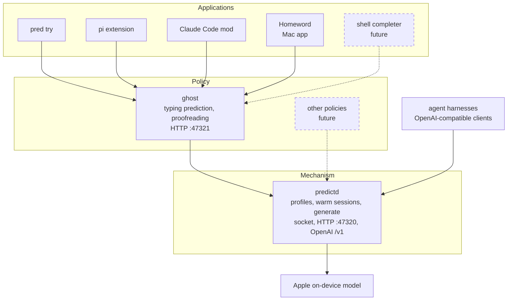

# Homeword


Homeword brings Apple's on-device language model (FoundationModels, macOS 27) to your typing and your tools: next-word suggestions
and proofreading in any app, ghost text in coding agents' prompt boxes, and a local OpenAI-compatible API. Everything runs on your
Mac. Your words never leave home.

## What it provides

- **The Homeword Mac app**: a menu bar app. While you type in any app, a pop-up shows the next words (about a quarter of a second,
  in a writing style that follows the app: chat, email, work documents, ...); Tab inserts a word. Select text and press ⌃⌥P to
  proofread it or ⌃⌥R to rewrite it. Every prompt is editable, with a built-in benchmark. [More](#the-homeword-mac-app)
  <!-- demo GIF: suggestions in Mail, then proofreading a paragraph -->
- **The engine**: runs the model on your Mac and turns its answers into suggestions (the rest of the unfinished word plus up to five
  words, one sentence) and proofreading. The `pred` command line tool starts it and lets you try it in a terminal (`pred try`); apps
  reach it over local HTTP. [Quick start](#quick-start)
  <!-- demo GIF: pred try in a terminal -->
- **An OpenAI-compatible API**: point any agent harness, SDK or tool at `http://127.0.0.1:47320/v1` to use the on-device model:
  chat completions with streaming, tool calls and JSON output. [More](#use-the-on-device-model-from-any-agent-harness)
  <!-- demo GIF: an agent harness running on the on-device model -->
- **Ghost text in pi**: suggestions while you type a prompt in the pi coding agent; Tab takes a word, → all. [More](#pi-ghost-text-in-pis-prompt-editor)
  <!-- demo GIF: ghost text in pi -->
- **Ghost text in Claude Code**: the same in Claude Code's prompt box, as a Claude Code mod. [More](#claude-code-ghost-text-in-the-prompt-box)
  <!-- demo GIF: ghost text in Claude Code -->

```
› Could you explain why the test is fail|ing despite correct preparation      ← dim ghost, Tab takes one word, → all
```

## How it is built

Three layers, keeping **mechanism and policy apart**:

- **predictd**: a model host, mechanism only. It keeps named system prompts ("profiles") with their prefix cache warm and
  generates plain or structured output with the limits each caller asks for. It knows nothing about typing. It also speaks the
  **OpenAI chat API**, so agent harnesses can use the on-device model directly.
- **ghost**: the policies (Python). Typing prediction owns the prompts and examples (one per writing style), the context trimming
  and the rules that turn the model's answer into a ghost (word glue, spelling, one sentence, up to five words by default).
  Proofreading fixes or rewrites a selected text. Together with predictd this is the engine.
- **Applications**: the Homeword Mac app, `pred try`, and the pi and Claude Code integrations. Other policies (summarise, commit
  messages, triage) can share the same predictd.



## Quick start

Requirements: macOS 27+ with Apple Intelligence enabled, the Xcode command line tools (`swiftc`), `python3` (standard library only,
no virtualenv).

```sh
./build.sh                    # swiftc -> ./predictd
bin/pred try                  # type and watch the ghost; Enter = new round with stats, Ctrl-C quits
bin/pred ask "git sta"        # one prediction with timings
bin/pred start                # predictd + the ghost HTTP server in the background (for pi, Claude Code)
bin/pred status               # daemon, profiles, policy knobs;  bin/pred stop

curl -s 127.0.0.1:47321/predict -d '{"app":"chat","text":"See you tomor"}'          # the typing policy
curl -s 127.0.0.1:47321/proofread -d '{"text":"i dont no","mode":"fix"}'           # the proofreading policy
curl -s 127.0.0.1:47320/ -d '{"op":"profile.set","name":"haiku","instructions":"Answer with a haiku."}'
curl -s 127.0.0.1:47320/ -d '{"profile":"haiku","prompt":"Autumn in the city","maxTokens":40}'   # the raw mechanism
curl -s 127.0.0.1:47320/v1/chat/completions -d '{"model":"apple-on-device","messages":[{"role":"user","content":"Hi!"}]}'
```

predictd starts on demand (any `pred` command or ghost request starts it); the ghost server starts with `pred start` or `pred serve`,
and the pi extension runs `pred start` itself. Both exit after 30 idle minutes.

## Applications

### The Homeword Mac app

A menu bar Mac app (prototype); your words never leave home. While you type in any app, a pop-up below the text cursor shows the
next words in a writing style that follows the app (Chat in Slack, Email in Mail or Gmail, Work documents in Pages or Google Docs,
...); Tab inserts the next word, Esc dismisses. Select text and press ⌃⌥P to fix typos and grammar, or ⌃⌥R to rewrite it, keeping
its meaning; Return replaces the selection. Settings has a writing style per app, every prompt editable with a built-in benchmark
and version history, configurable shortcuts, engine controls and the OpenAI-compatible API's address. It logs latency and acceptance
statistics (no text). Needs the Accessibility permission.

```sh
app/build.sh && open app/build/Homeword.app
```

Details, permissions and metrics: [app](app/README.md).

### `pred try`: try it in a terminal

An append-only line editor that asks for a ghost on every keystroke. **Tab** accepts one word, **→** all of it, **Esc** dismisses,
and typing the ghost's next character follows it instead of re-asking. Answers are remembered by text and the continuation of a shown
ghost is prefetched. **Enter** ends a round and prints its stats (keystrokes saved, suggestions shown and accepted, key → ghost
latency, cache share). `--app mail|chat|terminal|...` picks the context, `--log file` keeps rounds as JSON (your typed text: keep it
private).

### pi: ghost text in pi's prompt editor

A pi extension that replaces the prompt editor and draws the ghost after the cursor. Tab and → accept, as above.

```sh
pi -e integrations/pi/ghost-editor.ts
```

Details and permanent install: [integrations/pi](integrations/pi/README.md).

### Claude Code: ghost text in the prompt box

A Claude Code mod (a plugin with a hooks module) that paints the ghost as dim virtual text after the cursor. Accepting with Tab and
→ needs two entries in `keybindings.json`, which apply to every session: read
[integrations/claude-code](integrations/claude-code/README.md) before installing it.

Last keystroke → ghost on screen, human-like typing in tmux (Apple M4 Pro, macOS 27.2): pi 117 ms p50, Claude Code 157 ms p50.

## Use the on-device model from any agent harness

predictd serves an OpenAI-compatible API: base URL `http://127.0.0.1:47320/v1`, any API key, model `apple-on-device`. Chat
completions with streaming, tool calls (returned to the harness, OpenAI-style), JSON-schema output and the usual sampling
parameters. Tested with pi as the harness, including tool calls. The model's context window is 8192 tokens, so keep system
prompts small. Setup for the `openai` SDK, pi and others: [docs/OPENAI.md](docs/OPENAI.md).

## Documentation

| Document | For |
|---|---|
| [docs/ARCHITECTURE.md](docs/ARCHITECTURE.md) | the mechanism/policy split, how predictd works (profiles, sessions, cache, protocol), the ghost pipeline |
| [docs/OPENAI.md](docs/OPENAI.md) | the OpenAI-compatible API: connecting a harness, tool calls, parameters, limits |
| [docs/CONFIG.md](docs/CONFIG.md) | every knob: predictd.json, profile and generate fields, ghost/config.json, prompt.json, recipes |
| [docs/DEVELOPING.md](docs/DEVELOPING.md) | a new application, a new policy, changing predictd, testing |
| [docs/PERFORMANCE.md](docs/PERFORMANCE.md) | benchmarks, latency history, measuring pitfalls |
| [bench/RESULTS.md](bench/RESULTS.md) | current benchmark numbers |
| [AGENTS.md](AGENTS.md) | context and rules for AI agents and contributors |

## Status

A research prototype. Benchmark results (the best run per machine):

| Machine | Steady p50 | Typing key → ghost p50 |
|---|---|---|
| Apple M4 Pro, 16-core GPU, 48 GB, macOS 27.2 | 329 ms | 259 ms |
| Apple M4 Max, 32-core GPU, 36 GB, macOS 27.0.1 | 295 ms | 258 ms |

Details and raw data: [bench/RESULTS.md](bench/RESULTS.md).

Known limits: English only so far (prompt, examples and spell check); one warm prefix cache for the whole system (switching profiles
costs an uncached prefix); guesses from a one-letter prefix are often wrong; predictd reads one non-public field (`finishReason`, via
reflection), which macOS 27.0.1 does not have, so there a word cut by the token cap is kept. On a managed Mac, check whether Apple
Intelligence features may be used before relying on it.
