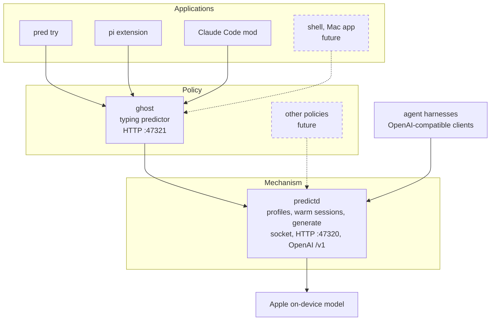

# input-predictor

Ghost-text typing prediction on Apple's on-device language model (FoundationModels, macOS 27). As you type, it suggests the rest
of the unfinished word plus the next few words, within one sentence, in about a quarter of a second. Nothing leaves the machine.

It is built in three layers, keeping **mechanism and policy apart**:

- **predictd**: a model host, mechanism only. It keeps named system prompts ("profiles") with their prefix cache warm and
  generates plain or structured output with the limits each caller asks for. It knows nothing about typing. It also speaks the
  **OpenAI chat API**, so agent harnesses can use the on-device model directly.
- **ghost**: the typing-prediction policy (Python). It owns the prompt and examples, the context trimming and the rules that turn
  the model's answer into a ghost (word glue, spelling, one sentence, five words).
- **Applications**: `pred try` in a terminal, ghost text in the pi and Claude Code prompt boxes, later a shell completer or a
  system-wide Mac app. Other policies (summarise, commit messages, triage) can share the same predictd.



```
› Could you explain why the test is fail|ing despite correct preparation      ← dim ghost, Tab takes one word, → all
```

## Quick start

Requirements: macOS 27+ with Apple Intelligence enabled, the Xcode command line tools (`swiftc`), `python3` (standard library only,
no virtualenv).

```sh
./build.sh                    # swiftc -> ./predictd
bin/pred try                  # type and watch the ghost; Enter = new round with stats, Ctrl-C quits
bin/pred ask "git sta"        # one prediction with timings
bin/pred start                # predictd + the ghost HTTP server in the background (for pi, Claude Code)
bin/pred status               # daemon, profiles, policy knobs;  bin/pred stop

curl -s 127.0.0.1:47321/predict -d '{"app":"chat","text":"See you tomor"}'          # the typing policy
curl -s 127.0.0.1:47320/ -d '{"op":"profile.set","name":"haiku","instructions":"Answer with a haiku."}'
curl -s 127.0.0.1:47320/ -d '{"profile":"haiku","prompt":"Autumn in the city","maxTokens":40}'   # the raw mechanism
curl -s 127.0.0.1:47320/v1/chat/completions -d '{"model":"apple-on-device","messages":[{"role":"user","content":"Hi!"}]}'
```

predictd starts on demand (any `pred` command or ghost request starts it); the ghost server starts with `pred start` or `pred serve`,
and the pi extension runs `pred start` itself. Both exit after 30 idle minutes.

## Sample applications

### `pred try`: try it in a terminal

An append-only line editor that asks for a ghost on every keystroke. **Tab** accepts one word, **→** all of it, **Esc** dismisses,
and typing the ghost's next character follows it instead of re-asking. Answers are remembered by text and the continuation of a shown
ghost is prefetched. **Enter** ends a round and prints its stats (keystrokes saved, suggestions shown and accepted, key → ghost
latency, cache share). `--app mail|chat|terminal|...` picks the context, `--log file` keeps rounds as JSON (your typed text: keep it
private).

### pi: ghost text in pi's prompt editor

A pi extension that replaces the prompt editor and draws the ghost after the cursor. Tab and → accept, as above.

```sh
pi -e integrations/pi/ghost-editor.ts
```

Details and permanent install: [integrations/pi](integrations/pi/README.md).

### Claude Code: ghost text in the prompt box

A Claude Code mod (a plugin with a hooks module) that paints the ghost as dim virtual text after the cursor. Accepting with Tab and →
needs two entries in `keybindings.json`, which apply to every session: read [integrations/claude-code](integrations/claude-code/README.md)
before installing it.

Measured in tmux with human-like typing, last keystroke → ghost on screen: pi 117-139 ms p50, Claude Code 157-161 ms p50.

## Use the on-device model from any agent harness

predictd serves an OpenAI-compatible API: base URL `http://127.0.0.1:47320/v1`, any API key, model `apple-on-device`. Chat
completions with streaming, tool calls (returned to the harness, OpenAI-style), JSON-schema output and the usual sampling
parameters. Tested with pi as the harness, including tool calls. The model's context window is 8192 tokens, so keep system
prompts small. Setup for the `openai` SDK, pi and others: [docs/OPENAI.md](docs/OPENAI.md).

## Documentation

| Document | For |
|---|---|
| [docs/ARCHITECTURE.md](docs/ARCHITECTURE.md) | the mechanism/policy split, how predictd works (profiles, sessions, cache, protocol), the ghost pipeline |
| [docs/OPENAI.md](docs/OPENAI.md) | the OpenAI-compatible API: connecting a harness, tool calls, parameters, limits |
| [docs/CONFIG.md](docs/CONFIG.md) | every knob: predictd.json, profile and generate fields, ghost/config.json, prompt.json, recipes |
| [docs/DEVELOPING.md](docs/DEVELOPING.md) | a new application, a new policy, changing predictd, testing |
| [docs/PERFORMANCE.md](docs/PERFORMANCE.md) | benchmarks, latency history, measuring pitfalls |
| [bench/RESULTS.md](bench/RESULTS.md) | current benchmark numbers |
| [AGENTS.md](AGENTS.md) | context and rules for AI agents and contributors |

## Status

A research prototype, measured on one machine (Apple M4 Pro, 48 GB). Known limits: English only so far (prompt, examples and spell
check), one warm prefix cache for the whole system (switching profiles costs an uncached prefix), guesses from a one-letter prefix are
often wrong, and predictd reads one non-public field (`finishReason`, via reflection). On a managed Mac, check whether Apple
Intelligence features may be used before relying on it.
