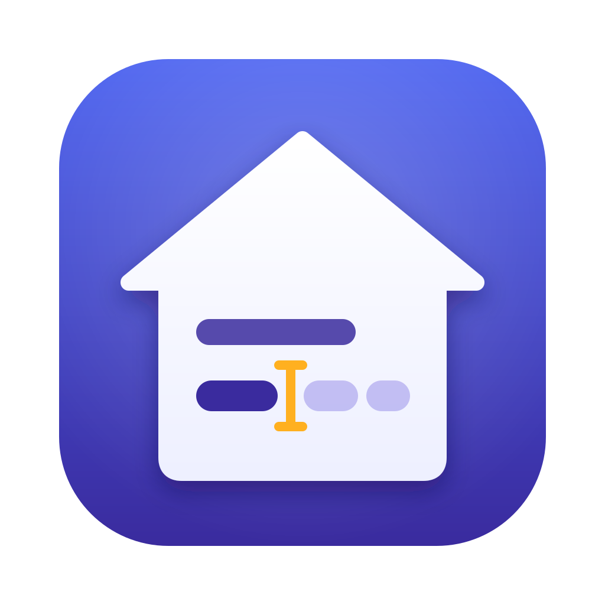
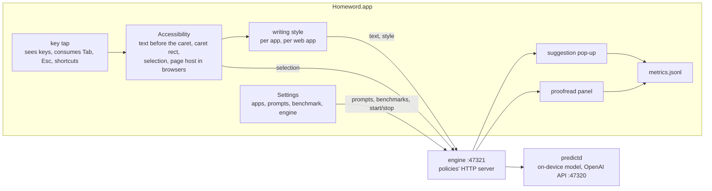

# Homeword: the Mac app (prototype)



Homeword is a menu bar app that suggests your next words and proofreads selected text in every app. It uses only Apple's
on-device model through the local engine, so your words never leave home (the Mac).

- **Next-word suggestions**: while you type, a small pop-up below (or next to) the text cursor shows the next words. **Tab** inserts
  the next word (the highlighted one), **Esc** dismisses, typing the suggestion's next letters keeps it, anything else asks again.
  Same interaction as `pred try` and the agent integrations.
- **Writing styles**: the prompt follows where you type: Chat in Messages or Slack, Email in Mail or Gmail, Work documents in Pages,
  Word or Google Docs, Academic in Overleaf, Code in Xcode or VS Code, General elsewhere. Adjustable per app; Off turns suggestions
  off for an app.
- **Proofreading**: select text and press **⌃⌥P** to fix typos, spelling, grammar and punctuation, or **⌃⌥R** to rewrite it more
  clearly (shortcuts configurable). Both keep the meaning and intent. A panel next to the selection shows the changes (removed
  words struck through, new ones in green) or the clean result, and scrolls for long texts. **Return** replaces the selection,
  **⌘C** copies the result, **Esc** cancels. The app being edited keeps its undo. A warning appears when a paragraph came back much
  shorter than it was (the model dropped something): check before replacing. Long texts take about 1 s per paragraph.
- **Prompts you can tune**: every prompt (one per writing style, proofread, rewrite) is editable, instructions and examples, with
  token counts, a built-in benchmark against the default, and the last 20 saved versions.
- **Statistics** for improving it: latency, acceptance, keystrokes saved, per writing style and app, proofreading outcomes. Counts
  and timings only, never text.

The app is UI only, with no prediction or proofreading logic. It calls the engine: the policies' HTTP server on `127.0.0.1:47321`
(`/predict`, `/warm`, `/proofread`, `/prompts`, `/tokens`, `/bench`, `/history`; see [docs/ARCHITECTURE.md](../docs/ARCHITECTURE.md)),
which uses predictd.



## Build and run

```sh
app/build.sh                              # swiftc -> app/build/Homeword.app (ad-hoc signed)
open app/build/Homeword.app
```

Needs macOS 27+ and the Xcode command line tools, the same as predictd. The app starts the engine itself (`bin/pred start` from the
repo it was built in) when it is not running, unless you stopped it in Settings → Engine. To start Homeword at login, add it in
System Settings → General → Login Items.

**Permissions.** The app asks for **Accessibility** (System Settings → Privacy & Security → Accessibility). It needs it to read the
focused text field and the caret position, to see key presses, and to insert accepted words. It starts working within 2 s of being
allowed. Password fields are never read.

**Rebuilding.** `build.sh` signs ad-hoc with a designated requirement on the bundle ID (`dev.homeword.app`) instead of the binary's
hash, so the permission survives rebuilds. With a code-signing certificate: `SIGN_IDENTITY="Apple Development: …" app/build.sh`
(`security find-identity -p codesigning` lists yours). If the menu still says "not allowed" after you allowed it, the entry belongs
to an older signature: remove it (–), or `tccutil reset Accessibility dev.homeword.app`, then relaunch the app and allow it again.
`~/Library/Application Support/Homeword/status.json` shows what the app currently has (Accessibility, the keyboard tap, Input
Monitoring, event posting). If Accessibility is allowed but the menu says "Keyboard: blocked", also allow the app in Privacy &
Security → Input Monitoring.

**From the first version (InputPredictor).** On first launch Homeword takes over its settings (excluded apps become Off) and moves
its metrics. The new bundle ID needs the Accessibility permission once more; remove the old InputPredictor entry from the list.

**macOS inline predictions.** macOS shows its own inline predictive text in many apps. With both on you see two suggestions, and Tab
may go to either. Turn off System Settings → Keyboard → Text Input → "Show inline predictive text", or Homeword's suggestions.

## Where it works

Suggestions need a text field that exposes its text and caret through Accessibility: native apps (TextEdit, Mail, Notes, Messages,
Pages, Xcode), and Safari. In Chrome-based browsers and Electron apps (Slack, VS Code) the app turns on their accessibility tree
(the "Chrome-based browsers" setting), which makes some of them slower. Where the caret position is unknown the pop-up sits at the
field's bottom left. Suggestions appear only at the end of a line, as in the other integrations.

Proofreading uses the Accessibility selection, or copies the selection (⌘C, the pasteboard is restored) where that is not exposed.
Replace pastes the result, so it works wherever paste does.

Terminals and password managers are Off by default: shells have their own completion and Tab.

## Settings

Menu → Settings… (⌘,) opens one window with five tabs.

**General.** Suggest while typing (also in the menu); pop-up position (below or next to the cursor); words to suggest (1-10, 5 by
default: an engine setting, so `pred` and the agent integrations follow it; it fills `{words}` in the prompts); start after N characters (3);
Chrome-based browsers and Electron apps (on); proofread and rewrite selected text (on), with a shortcut recorder for each: click,
press a combination with ⌘, ⌃ or ⌥ (Esc cancels, Delete removes the shortcut). A warning shows when both are the same or the
combination is a plain ⌘ shortcut that apps use.

**Apps.** Every app with a built-in style that is installed, plus the apps you added (+: a running app, or Choose…). Per app:
Automatic (the built-in style, shown in brackets), a style, or Off. − removes your setting. In browsers, Automatic means the web
app's style by host name (Gmail → Email, Slack → Chat, Google Docs and Notion → Work documents, Overleaf → Academic, GitHub →
Code); the host is used in memory only. Built-in tables: `Sources/Styles.swift`.

**Prompts.** A list of the prompts: Suggestions (General, Chat, Email, Work documents, Academic, Code) and Proofreading (Proofread,
Rewrite); a dot marks your version. For the selected one:

- Instructions, and the examples in a two-box editor: typed text on the left, its continuation on the right, paired by line
  number (line 3 left goes with line 3 right). Both boxes have the same height, scroll together and show line numbers; the line
  being edited is highlighted and underlined in both. Spaces at the start or end of a line are shaded, because they matter. Up to 12
  examples; the model imitates them more than the instructions. In suggestion prompts `{words}` becomes the number of words to
  suggest, and a continuation starts with the rest of an unfinished word (no space), or a space after a whole word.
- Examples count, characters, tokens of the instructions and of the whole prompt as sent, and its cost: about 0.55 ms per token
  on every request.
- Save (⌘S) applies it to the next request; Revert drops unsaved edits; Reset to Default restores the shipped prompt.
- **Your test cases**: the same two-box editor (typed text | what comes next; for proofreading, text | corrected text). Saved per
  prompt as you type, on this Mac, outside the repo.
- **Benchmark**: the built-in test cases (200 texts from `bench/cases.json` and `bench/styles.json`, at least 25 per category),
  each tagged with a category: Chat, Email, Work documents, Academic, Code, General, Terminal. View… opens them read-only, per
  category (typed text | what comes next, the same paired view as the editors). A case that shares text with one of the prompt's
  examples is left out (a note says how many, and the viewer marks its line): it would test recall, not prediction. Run Full Benchmark runs the draft (or the saved prompt) on all of
  them plus your cases; Run Your Cases runs only yours; Run Default runs the shipped prompt for comparison. A progress bar counts
  the cases (a full run takes about a minute; suggestions pause meanwhile). The results table has a row per category, All categories,
  and Your cases as its own row: cases, next word right, words right (mean matching leading words), word completions right, shown
  and latency p50, with the difference to the default prompt in green or red. Proofreading: fully corrected and word match on 12
  sentences with known mistakes; rewriting: length and latency only.
- **Saved versions**: the last 20 per prompt, with their benchmark results. Load puts one back in the editor.
- An ⓘ next to each section and column name explains it when the pointer rests on it (also on the Statistics tab).

Every suggestion type has its own examples, chosen on separate tuning cases and checked on the benchmark (bench/RESULTS.md):
Email, Work documents and Academic have their own instructions and six examples; Chat has General's instructions with a line about
chat and six chat examples; Code keeps General's instructions, four of its mixed examples and two code examples, because six
code-only examples lost to the mixed ones.
Prompts and history are kept by the engine in `~/.config/input-predictor/` (`prompts.json`, `prompt-history.json`), outside the
repo, so `pred try` and the agent integrations use them too.

**Statistics.** Suggestions shown and accepted, words, keystrokes saved, key → pop-up latency, by writing style and by app, and
proofreading outcomes. Reveal the file, Reset, Refresh.

**Engine.** A colored dot: green running, yellow starting or stopping, red stopped. Start, Stop and Restart. After Stop, suggestions
and proofreading pause and the app does not restart the engine until Start. The engine's port (47321) and the OpenAI-compatible
API's (47320) can be changed: Apply and Restart saves them to `~/.config/input-predictor/config.json` (`serverPort`) and
`predictd.json` (`httpPort`), which `pred` reads too (the pi and Claude Code integrations have their own port setting). The API
section shows the base URL, model and key to copy into other apps, and its own status dot. Permissions shows the Accessibility
state.

## Metrics

One JSON object per line in `~/Library/Application Support/Homeword/metrics.jsonl`. **No text is ever recorded**: only counts,
lengths, timings, outcomes, the writing style and the app's bundle ID. `bench/app_metrics.py` summarises it (`--json`, `--since
2026-11-01`). It stays on the machine: don't commit it.

| `kind` | When | Fields |
|---|---|---|
| `suggestion` | a shown suggestion ends (used up, replaced by a new one, dismissed) | `style`, `latency_ms` (key → pop-up), `model_ms`, `words`, `chars`, `accepted_words` (Tab presses), `accepted_chars`, `typed_along` (characters typed that matched it), `outcome` |
| `request` | a request shows nothing | `style`, `outcome` (`empty`, `suppressed: invalid_word`, `error: …`), `latency_ms` |
| `keys` | every minute | `n`: characters typed and deleted in readable text fields, per app |
| `proofread` | the panel closes | `mode`, `outcome` (`replaced`, `copied`, `cancelled`, `failed`), `latency_ms`, `chars_in`, `chars_out`, `edits` |

`outcome` of a suggestion: `accepted_all`, `accepted_part`, `typed_along` (typed along at least 2 characters without Tab), else how
it ended: `ignored` (typed something else), `dismissed` (Esc, click, app switch), `replaced`. Keystrokes saved = `accepted_chars` −
Tab presses.

## Source

| File | What |
|---|---|
| `Sources/App.swift` | entry, menu bar item and menu, shortcuts, permissions, the Settings window |
| `Sources/SettingsView.swift` | the Settings tabs: General, Apps, Statistics, Engine |
| `Sources/PromptsView.swift` | the Prompts tab: editor, token counts, test cases, benchmark per category, saved versions |
| `Sources/PairedLinesEditor.swift` | the two-box, line-paired editor (examples and test cases) |
| `Sources/Styles.swift` | writing styles: built-in tables by bundle ID and web host, the user's choices |
| `Sources/Hotkeys.swift` | shortcuts: matching, display, the recorder |
| `Sources/Predictor.swift` | the suggestion loop: read the field, pick the style, ask, check the text is unchanged, show, follow, accept |
| `Sources/SuggestionPanel.swift` | the pop-up: a borderless panel that never takes focus |
| `Sources/Proofreader.swift` | selection → `/proofread` → the diff panel → paste |
| `Sources/AX.swift` | Accessibility: focused field, text before the caret, caret rect, selection, a browser page's host |
| `Sources/Input.swift` | the key tap, synthetic typing (tagged so the tap ignores it), pasteboard save and restore |
| `Sources/Services.swift` | preferences and migration, the engine client: requests, health, start/stop, ports |
| `Sources/Metrics.swift` | the metrics file and the summary |

Design notes for this version: [DESIGN.md](DESIGN.md).

## Icon

`Icon/icon.svg` (the app icon: a house holding a line of text, the cursor and the suggested words) and `Icon/menubar.svg` (the menu
bar version, black on transparent: macOS tints it as a template image). `build.sh` renders them with AppKit (`Icon/svg2png.swift`)
into `AppIcon.icns` (16 to 1024 px, via `iconutil`) and `MenuBarIcon.png` / `@2x`. Edit the SVGs and rebuild.

## Developing

`app/build.sh` compiles with the command line tools' `swiftc`. On macOS 27 SDKs SwiftUI's `@State` is a macro whose plugin
ships only with Xcode, so the views keep their state in `ObservableObject`s (`@StateObject`, `@ObservedObject`, `@AppStorage`
compile without it). Launch arguments for checking the UI without a target app:

```sh
open app/build/Homeword.app --args -show prompts                # general, apps, prompts, stats, engine
open app/build/Homeword.app --args -show prompts -promptsSelect predict-chat -promptsAnchor bench   # a prompt's benchmark
open app/build/Homeword.app --args -demoProofread file.txt [-demoMode rewrite]   # the panel on a file's text; Replace is off
```

## Known limits

- Prototype. Single-line `NSTextField`s in some apps report no caret rect: the pop-up sits under the field.
- Proofreading a long text shows a spinner until all paragraphs are done (about 1 s each); no progress per paragraph yet.
- Synthetic typing goes to the focused app. If focus moves between the Tab press and the insertion, the word lands there.
- The first keystroke in a style with a different prompt (Work documents, or one you changed) is ~70 ms slower; switching apps warms
  it in advance. After a proofread, the first keystroke is slower once too.
- Web app detection is untested in Firefox; where no page URL is exposed, web apps use the browser's style (General).
- On a managed Mac, check whether Apple Intelligence features may be used before relying on this.
