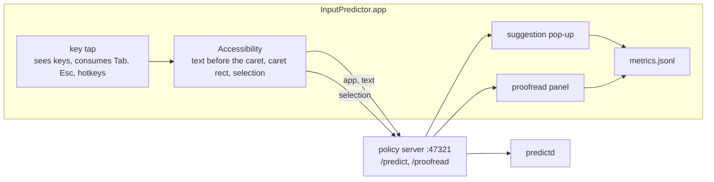

# InputPredictor: the Mac app (prototype)

A menu bar app that brings the two policies to every text field on the Mac, using only the local services and Apple's on-device
model:

- **Input prediction**: while you type, a small pop-up below (or next to) the text cursor shows the next words. **Tab** inserts the
  next word (the highlighted one), **Esc** dismisses, typing the suggestion's next letters keeps it, anything else asks again.
  Same interaction as `pred try` and the agent integrations.
- **Proofreading**: select text and press **⌃⌥P** to fix typos, spelling, grammar and punctuation, or **⌃⌥R** to rewrite it more
  clearly. Both keep the meaning and intent. A panel next to the selection shows the changes (removed words struck through,
  new ones in green). **Return** replaces the selection, **⌘C** copies the result, **Esc** cancels. The app being edited keeps its
  undo.
- **Metrics** for improving the app: latency, acceptance, keystrokes saved, proofreading outcomes. Counts and timings only, never
  text (below).

The app is UI only, with no prediction or proofreading logic. It calls the policy server (`POST /predict`, `POST /proofread` on
`127.0.0.1:47321`, see [docs/ARCHITECTURE.md](../docs/ARCHITECTURE.md)), which uses predictd.



## Build and run

```sh
app/build.sh                              # swiftc -> app/build/InputPredictor.app (ad-hoc signed)
open app/build/InputPredictor.app
```

Needs macOS 27+ and the Xcode command line tools, the same as predictd. The app starts the services itself (`bin/pred start` from the
repo it was built in) when they are not running. To start it at login, add it in System Settings → General → Login Items.

**Permissions.** The app asks for **Accessibility** (System Settings → Privacy & Security → Accessibility). It needs it to read the
focused text field and the caret position, to see key presses, and to insert accepted words. It starts working within 2 s of being
allowed. Password fields are never read.

**Rebuilding.** `build.sh` signs ad-hoc with a designated requirement on the bundle ID (`dev.inputpredictor.menubar`) instead of
the binary's hash, so the permission survives rebuilds. With a code-signing certificate: `SIGN_IDENTITY="Apple Development: …"
app/build.sh` (`security find-identity -p codesigning` lists yours). If the menu still says "not allowed" after you allowed it, the
entry belongs to an older signature: remove it (–), or `tccutil reset Accessibility dev.inputpredictor.menubar`, then relaunch the
app and allow it again. `~/Library/Application Support/InputPredictor/status.json` shows what the app currently has (Accessibility,
the keyboard tap, Input Monitoring, event posting). If Accessibility is allowed but the menu says "Keyboard: blocked", also allow
the app in Privacy & Security → Input Monitoring.

**macOS inline predictions.** macOS shows its own inline predictive text in many apps. With both on you see two suggestions, and Tab
may go to either. Turn off System Settings → Keyboard → Text Input → "Show inline predictive text", or this app's predictions.

## Where it works

Prediction needs a text field that exposes its text and caret through Accessibility: native apps (TextEdit, Mail, Notes, Messages,
Pages, Xcode), and Safari. In Chrome-based browsers and Electron apps (Slack, VS Code) the app turns on their accessibility tree
(the "Chrome-based browsers" setting), which makes some of them slower. Where the caret position is unknown the pop-up sits at the
field's bottom left. Suggestions appear only at the end of a line, as in the other integrations.

Proofreading uses the Accessibility selection, or copies the selection (⌘C, the pasteboard is restored) where that is not exposed.
Replace pastes the result, so it works wherever paste does.

Terminals and password managers are excluded by default (Settings → "Never predict in these apps").

## Settings

| Setting | Default | What it does |
|---|---|---|
| Predict while typing | on | the input prediction; also in the menu |
| Pop-up position | below the cursor | or next to it |
| Start after N characters | 3 | no request for shorter text |
| Chrome-based browsers | on | turn on the accessibility tree of Chromium and Electron apps |
| Proofread and rewrite the selection | on | the ⌃⌥P and ⌃⌥R hotkeys |
| Never predict in these apps | terminals, password managers | bundle IDs, one per line (`osascript -e 'id of app "Slack"'`) |
| Policy server | `http://127.0.0.1:47321` | where `/predict` and `/proofread` are |

The app sends a context label with each request, chosen by bundle ID (`mail`, `chat`, `code`, else `notes`: `appLabel` in
`Sources/Services.swift`). The typing policy's knobs (words, tokens, spelling, ...) are in `ghost/config.json`
([docs/CONFIG.md](../docs/CONFIG.md)), and the proofreading prompts are in `ghost/proofread.py`.

## Metrics

One JSON object per line in `~/Library/Application Support/InputPredictor/metrics.jsonl`. **No text is ever recorded**: only
counts, lengths, timings, outcomes and the app's bundle ID. Menu → Statistics… shows a summary. Settings can reveal or reset the
file. `bench/app_metrics.py` summarises it (`--json`, `--since 2026-11-01`). It stays on the machine: don't commit it.

| `kind` | When | Fields |
|---|---|---|
| `suggestion` | a shown suggestion ends (used up, replaced by a new one, dismissed) | `latency_ms` (key → pop-up), `model_ms`, `words`, `chars`, `accepted_words` (Tab presses), `accepted_chars`, `typed_along` (characters typed that matched it), `outcome` |
| `request` | a request shows nothing | `outcome` (`empty`, `suppressed: invalid_word`, `error: …`), `latency_ms` |
| `keys` | every minute | `n`: characters typed and deleted in readable text fields, per app |
| `proofread` | the panel closes | `mode`, `outcome` (`replaced`, `copied`, `cancelled`, `failed`), `latency_ms`, `chars_in`, `chars_out`, `edits` |

`outcome` of a suggestion: `accepted_all`, `accepted_part`, `typed_along` (typed along at least 2 characters without Tab), else how
it ended: `ignored` (typed something else), `dismissed` (Esc, click, app switch), `replaced`. Keystrokes saved = `accepted_chars` −
Tab presses.

## Source

| File | What |
|---|---|
| `Sources/App.swift` | entry, menu bar item and menu, hotkeys, the Settings and Statistics windows |
| `Sources/Predictor.swift` | the prediction loop: read the field, ask, check the text is unchanged, show, follow, accept |
| `Sources/SuggestionPanel.swift` | the pop-up: a borderless panel that never takes focus |
| `Sources/Proofreader.swift` | selection → `/proofread` → the diff panel → paste |
| `Sources/AX.swift` | Accessibility: focused field, text before the caret, caret rect, selection |
| `Sources/Input.swift` | the key tap, synthetic typing (tagged so the tap ignores it), pasteboard save and restore |
| `Sources/Services.swift` | preferences, app labels, the HTTP client, starting the services |
| `Sources/Metrics.swift` | the metrics file and the summary |

## Known limits

- Prototype. Single-line `NSTextField`s in some apps report no caret rect: the pop-up sits under the field.
- Synthetic typing goes to the focused app. If focus moves between the Tab press and the insertion, the word lands there.
- After a proofread, the first keystroke's request is uncached: the proofreading profile took the model's one prefix cache (~0.3 s
  extra once).
- On a managed Mac, check whether Apple Intelligence features may be used before relying on this.
