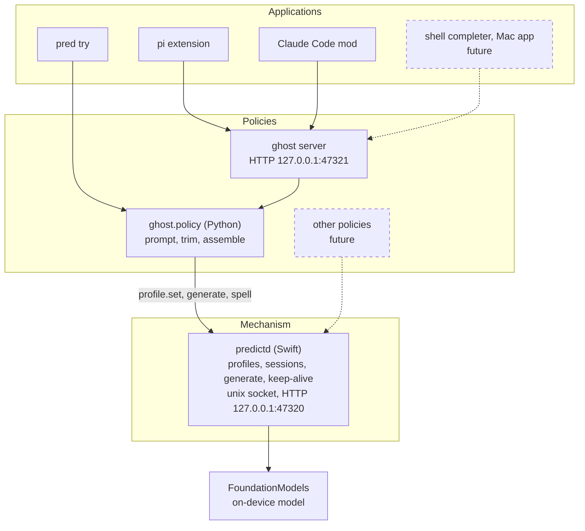
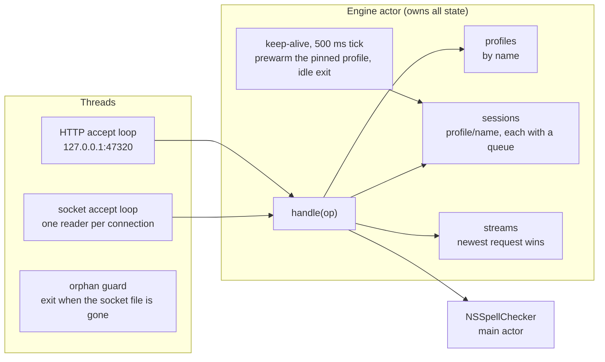
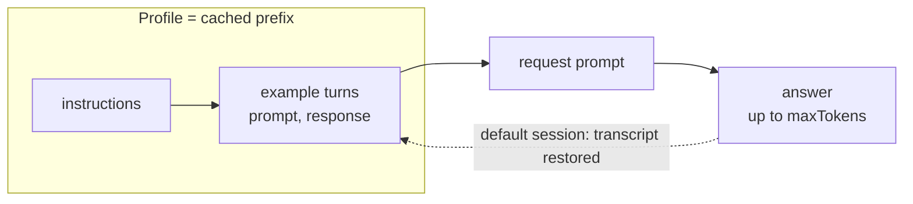
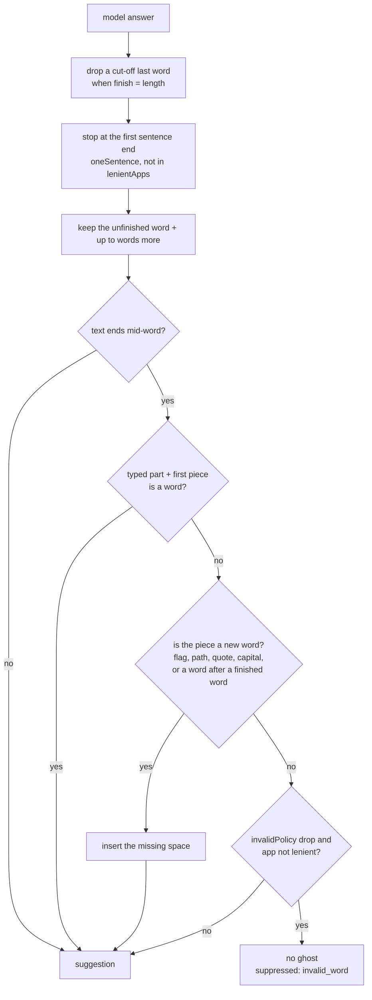
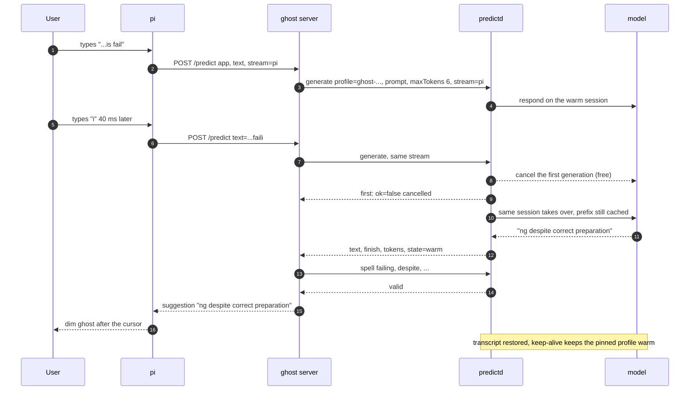

# Architecture

The project is split by one rule: **separate mechanism from policy.**

- **Mechanism: `predictd`** (Swift) hosts Apple's on-device model and nothing else. It keeps named system prompts ("profiles"),
  keeps one of them warm, and generates plain or structured output with the limits the caller asks for. It assumes nothing about
  what the text is for.
- **Policy: `ghost/`** (Python) is the typing predictor: what to ask while someone types, and how to turn the answer into ghost text.
  It is one client of the mechanism; a summariser, a commit-message writer or a triage bot would be others, side by side.
- **Applications** use a policy: `pred try` imports it, pi and Claude Code reach it over HTTP.



| predictd provides (mechanism) | ghost decides (policy) |
|---|---|
| host the model, keep a profile's prefix warm (`pin`) | pin its own profile |
| profiles: instructions, example turns, optional schema, guardrails, default options | the instructions, the examples, the `App: … Text: …` template |
| `generate` with `maxTokens`, sampling, plain or structured output | 6 tokens, greedy, plain |
| newest request wins per `stream`, one generation at a time per session, `cancel` | one stream per input field |
| stateless sessions, or conversations that keep their turns | stateless |
| finish reason (`length` or `stop`) | drop a word cut by the token cap |
| OS text services: `tokens`, `spell` | what counts as a word, when to show nothing |

## predictd: the mechanism

### Inside the process



All state lives in one Swift actor, so requests, the keep-alive and profile changes never race. Listener threads only parse and
hand requests to `Engine.handle`; answers go back on the connection (a JSON line on the socket, one response per HTTP request).

### Profiles, sessions and the cache

Measured facts that shape the design (M4 Pro, macOS 27.2):

- The on-device model keeps **one prefix KV cache for the whole system**: only the session that prewarmed or generated last keeps
  it. Any other session, in any process, evicts it, and it expires after ~5-6 s idle.
- Cost of a request: ~100 ms fixed, ~0.55 ms per cached input token, ~2 ms per uncached input token, ~16 ms per output token.
- No token streaming for short answers, no stop sequences; cancelling a running generation is free.

So a **profile** (instructions + example turns) becomes a session whose transcript is the cached prefix, and every request on the
default session puts the transcript back afterwards:



- **Default session** (`session` omitted): stateless. After each answer `session.transcript = base`, so the next request matches the
  cache: the whole prefix and often the start of the previous prompt.
- **Named sessions** (`session: "conv1"`, `keep: true`): the turns stay, for a conversation. `session.drop` forgets one.
- **Pinning**: the keep-alive prewarms the pinned profile while idle: at once when another session took the cache, otherwise every
  `keepAliveSec`. Without a pin it keeps the most recently used session warm. Using several profiles is fine; each switch costs one
  uncached prefix (~2 ms per token).
- **Order**: generations on one session run one after another; a newer request with the same `stream` cancels the older one (it
  answers `{"ok":false,"error":"cancelled"}`) and takes its place.
- Each answer reports the cache `state` it met: `warm`, `expired` (idle too long), `evicted` (another session had the cache) or
  `cold` (a new session).

### Protocol

Newline-delimited JSON on the unix socket `/tmp/predictd-UID.sock` (mode 0600), or the same objects as the body of an HTTP `POST` to
`127.0.0.1:47320` (`op` defaults to `generate`; `GET /health`). Every request may carry an `id`, echoed in its answer.

| Op | Request | Answer |
|---|---|---|
| `profile.set` | `name`, `instructions`, `examples: [{prompt, response}]`, `schema`, `guardrails` (`default`/`permissive`), `defaults: {maxTokens, ...}`, `pin` | `changed` (false when the definition is identical: its warm sessions are kept), `prefix_tokens` |
| `profile.pin` | `name` (or null to unpin) | `pinned` |
| `profile.drop` | `name` | |
| `generate` | `profile`, `prompt`, `session`, `keep`, `stream`, `maxTokens`, `sampling` (`greedy`/`topK`/`topP`), `topK`, `topP`, `temperature`, `seed`, `schema` (`true` = the profile's, or a JSON schema), `schemaInPrompt` | `text` or `content` (structured), `finish` (`length`/`stop`), `tokens: {in, cached, out}`, `timing: {wait_ms, model_ms, total_ms}`, `state` |
| `cancel` | `stream` | |
| `session.drop` | `profile`, `session` | |
| `tokens` | `text` | `count` |
| `spell` | `words`, `language` | `valid: [bool]` (`NSSpellChecker`) |
| `stats` | | counters, `profiles`, `pinned`, `warm`, `config` |
| `reload` | `config: {...}` | re-reads predictd.json, applies `config` on top |
| `ping`, `shutdown` | | |

Errors: `{"ok":false,"error":...}` with `cancelled`, `unknown_profile` (register it, then retry: a restarted daemon has none),
`guardrail`, or a message. Schemas are a JSON Schema subset: `object` (`properties`, `required`, `propertyOrder`), `array`
(`items`, `minItems`, `maxItems`), `string` (with `enum`), `integer`, `number`, `boolean`. Example responses of a structured
profile are JSON objects.

```sh
# a structured profile and a request, over HTTP
curl -s 127.0.0.1:47320/ -d '{"op":"profile.set","name":"triage","instructions":"Triage the issue report.",
  "schema":{"type":"object","propertyOrder":["category","urgent"],"properties":{
    "category":{"type":"string","enum":["bug","feature","question"]},"urgent":{"type":"boolean"}}}}'
curl -s 127.0.0.1:47320/ -d '{"profile":"triage","prompt":"Could you add a dark mode?","schema":true}'
# {"ok":true,"content":{"category":"feature","urgent":false},"finish":"stop","state":"cold",...}
```

### Lifecycle

- **Start**: `pred start` (or any client through `ghost.predictd.start`) runs `./predictd`; it listens within a second. No profiles
  exist until clients register them.
- **One per user**: a new daemon that finds a live one on the socket exits; a daemon whose socket file is removed or replaced exits.
- **Idle**: keep-alive for `keepAliveMaxIdleSec` (5 min) after the last request, exit after `idleExitSec` (30 min).
- **Logs**: stderr, `/tmp/predictd-UID.log` when started by `pred`.
- **Non-public bits**: the finish reason is read from the transcript through `Mirror` (`Transcript.Response.finishReason`); if an
  OS update breaks it, every answer reports `stop`. Settable `session.transcript` is macOS 27 API.

## ghost: the typing policy

`ghost/policy.py` registers one profile built from `ghost/prompt.json` (instructions + the first `shots` examples, named by a hash
of its content) and pins it. Then, per keystroke:

| Step | What happens | Knobs (ghost/config.json) |
|---|---|---|
| 1 trim | Keep the tail of the text that fits `textBudget` tokens, cut on a word boundary (char estimate: 4.8 chars/token prose, 2.9 code/shell, 1.6 CJK). | `textBudget` |
| 2 ask | `generate` on its profile with prompt `App: <app>\nText: <tail>`, `maxTokens`, sampling; plain text, or a one-field schema with `output: structured`. | `maxTokens`, `sampling`, `output` |
| 3 assemble | Turn the answer into the ghost (below); words are checked with predictd's `spell` op, batched once per answer. | `words`, `oneSentence`, `invalidPolicy`, `lenientApps`, `spellCheck`, `spellLanguage`, `format` |

The model is asked for the **rest** of the unfinished word, then the next words ("suffix" format): for `...is fail` it answers
`ing despite correct preparation`.



Days and months also count as words in their capitalised form. Sentence ends ignore abbreviations ("e.g.", "Dr."), initials and
numbers, and the rule is off for `lenientApps` (terminal, code), where `.` and `!` are syntax.

### One keystroke through all layers



### The ghost answer

`POST 127.0.0.1:47321/predict` with `{"app": "chat", "text": "See you tomor", "stream": "pi", "opts": {...}}` (`opts` overrides
ghost/config.json for one request), or `Ghost.predict()` in Python:

| Field | Meaning |
|---|---|
| `suggestion` | text to show after the cursor, exactly as it should be inserted (may start with a space); `""` = no ghost |
| `partial`, `first_word` | the unfinished word at the end of `text` (`tomor`); the first whole word of the suggestion (`tomorrow`) |
| `valid`, `suppressed` | spell check of the completed word; why nothing is shown (`invalid_word`, `guardrail`) |
| `raw_suggestion`, `model_completion` | before suppression; the model's raw text |
| `truncated`, `dropped_partial`, `sentence_end`, `glued`, `respaced`, `words`, `misspelled` | what assembly did |
| `timing` | `trim_ms`, `wait_ms`, `model_ms`, `assemble_ms`, `daemon_ms`, `total_ms`, `session` (the cache state) |
| `tokens` | `in`, `cached`, `out` from predictd, plus the trim details |
| `ok:false` | `error: "cancelled"` when a newer request on the stream replaced this one: ignore it |
