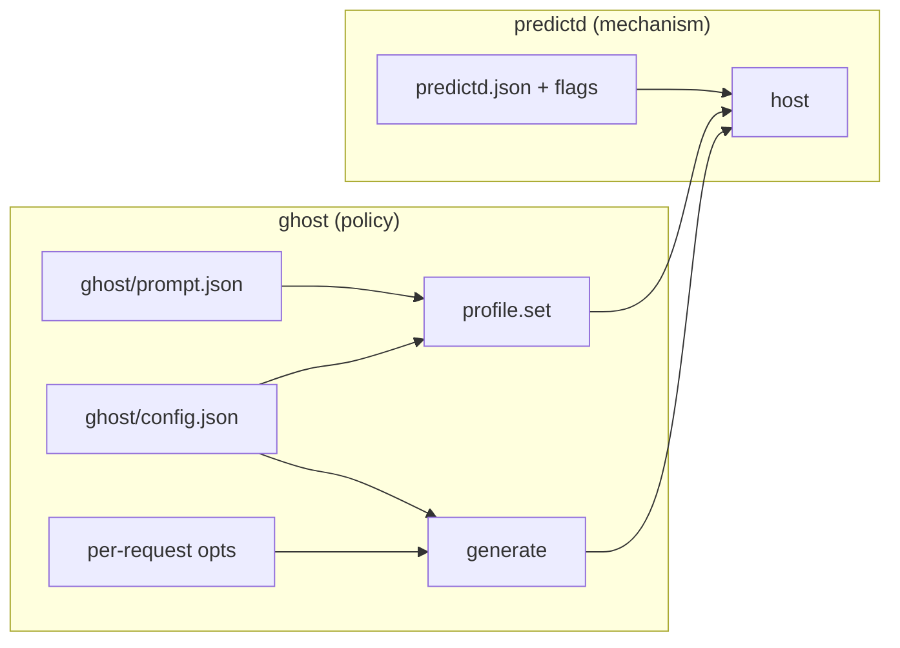

# Knobs

Knobs follow the mechanism/policy split ([ARCHITECTURE.md](ARCHITECTURE.md)):

| Layer | Where | What |
|---|---|---|
| Mechanism | `predictd.json`, daemon flags | how the host runs: socket, port, keep-alive, idle exit |
| Mechanism, per caller | `profile.set` and `generate` fields | what a client asks for: instructions, examples, schema, guardrails, token limit, sampling |
| Policy | `ghost/config.json`, `ghost/prompt.json` | how the typing predictor uses the model: context size, words, spell rules, its prompt |

`pred status` prints the daemon's config, its profiles and the policy's config in effect.

## predictd.json (mechanism)

| Knob | Shipped | What it does |
|---|---|---|
| `keepAliveSec` | 3 | prewarm the pinned (or last used) session this often while idle; the cache expires after ~5-6 s. 0 = never |
| `keepAliveMaxIdleSec` | 300 | stop prewarming after this long without requests |
| `idleExitSec` | 1800 | exit after this long without requests; 0 = never |
| `cacheTTLSec` | 5.5 | after this long unused, a session's cache counts as `expired` in answers (reporting only) |
| `maxSessions` | 32 | sessions kept before the least recently used idle one is forgotten (never the pinned profile's) |
| `httpPort` | 47320 | HTTP on 127.0.0.1; 0 = off. Restart to change |
| `socketPath` | /tmp/predictd-UID.sock | the unix socket. Restart to change |

`reload` re-reads it without a restart (except the two listeners). Flags: `./predictd [--config path] [--socket path]
[--http-port n] [--version]`; the default config is predictd.json next to the binary. A private daemon for experiments:
`./predictd --socket /tmp/my.sock --http-port 0`.

## Profile and generate fields (mechanism, chosen by each client)

| Field | In | Default | What it does |
|---|---|---|---|
| `instructions`, `examples` | profile | none | the system prompt and example turns: the cached prefix of every request |
| `schema` | profile, generate | none | JSON schema for structured answers (`generate` with `schema: true` uses the profile's) |
| `guardrails` | profile | default | `permissive` (`permissiveContentTransformations`) refuses less |
| `defaults` | profile | none | default generate fields for this profile, e.g. `{"maxTokens": 40}` |
| `maxTokens` | generate | the model's | output cap; the answer's `finish` is `length` when it was hit |
| `sampling` | generate | greedy | `greedy` (deterministic), `topK`, `topP` |
| `topK`, `topP`, `temperature`, `seed` | generate | 40, 0.9, model's, random | random sampling parameters (`temperature`, `seed` < 0 = unset) |
| `session`, `keep` | generate | default session, false | a named session, and whether it keeps its turns (conversation) |
| `stream` | generate | none | requests on one stream replace each other |
| `schemaInPrompt` | generate | false | also describe the schema in the prompt |

## ghost/config.json (policy)

| Knob | Shipped | What it does | Trade-off |
|---|---|---|---|
| `words` | 5 | words shown after the unfinished word; also fills `{words}` in the instructions | more words = more output tokens (~16 ms each) and more wrong guesses |
| `maxTokens` | 6 | the model's output cap; a word cut by it is dropped | the biggest latency lever; raise with `words` |
| `textBudget` | 100 | tokens of typed text the model sees (the tail) | ~0.55 ms per cached token, ~2 ms uncached |
| `oneSentence` | true | stop the ghost at the end of the first sentence | |
| `invalidPolicy` | drop | `drop`: no ghost when the completed word is not a word; anything else shows it | |
| `lenientApps` | terminal, code | apps where words need not be dictionary words and the sentence rule is off | add labels for code-like input |
| `spellCheck`, `spellLanguage` | true, en | check completed words with predictd's `spell` op, in this language | the prompt is English: change both together |
| `sampling`, `topK`, `topP`, `temperature`, `seed` | greedy, ... | passed to `generate` | greedy is the most accurate |
| `shots` | 6 | examples from prompt.json in the profile | each costs ~0.55 ms per token per request; fewer cost accuracy |
| `instructions` | short | `short` (`instructions_short`) or `long` (`instructions`) | short was faster and more accurate |
| `format` | suffix | `suffix`: the model writes the rest of the word; `fullword`: it rewrites the last word (`instructions_fullword`) | suffix is better |
| `output` | plain | `plain`, or `structured` (a one-field schema; shows off the mechanism) | structured is ~200 ms slower |
| `guardrails` | permissive | the profile's guardrails | |
| `serverPort`, `serverIdleExitSec` | 47321, 1800 | the ghost HTTP server's port and idle exit | |

Every knob also works per request: `pred ask "text" --opts '{"words":8}'`, `pred try --opts ...`, or `opts` in a ghost HTTP request.
Knobs that change the prompt (`shots`, `instructions`, `format`, `output`, `guardrails`, `words`) make a different profile
(named by the hash of its content), registered on first use: the first request with them is uncached.

## ghost/prompt.json (policy)

| Field | What it is |
|---|---|
| `instructions_short` | the instructions used by default; `{words}` is replaced by `words` |
| `instructions`, `instructions_fullword` | the long variant and the one for `format: fullword` |
| `template` | the prompt for every request and every example: `App: {app}\nText: {text}` |
| `shots` | examples `{app, text, completion}`; the first `shots` of them are used, in order, so put the best first |

A `completion` follows the suffix format: for `"text": "I will send you the docu"` it is `"ment by the end of the day"`. The
example `app` labels are the vocabulary clients should send (`terminal`, `mail`, `chat`, `notes`, `code`, `review`, `essay`); add
examples when you add a new kind of client. The prefix is ~280 tokens with 6 examples, paid on every request. After editing,
restart `pred` clients (the profile name changes with the content) and re-run the benchmark ([PERFORMANCE.md](PERFORMANCE.md)).

## pred CLI

| Command | Flags |
|---|---|
| `pred try` | `--app auto\|terminal\|mail\|chat\|...`, `--debounce ms` (0), `--min-chars` (2), `--words` (prefetch extends the ghost up to this), `--opts '{...}'`, `--log file`, `--no-spawn` |
| `pred ask "text"` | `--app`, `--opts` |
| `pred serve` | `--port` (the ghost server in the foreground) |
| `pred start`, `pred stop`, `pred status` | predictd + the ghost server in the background |

## Integrations

| | Setting | Default |
|---|---|---|
| pi | env `GHOST_PORT`, `GHOST_APP`, `PRED_CLI` | 47321, `coding agent prompt`, the repo's `bin/pred` |
| Claude Code | constants `URL`, `APP` at the top of `hooks/register.ts` | `http://127.0.0.1:47321/predict`, `coding agent prompt` |

Both send at most the last 2000 characters; the policy trims further to `textBudget`.

## Recipes

| Goal | Change (ghost/config.json or `opts`) |
|---|---|
| Longer ghosts | `words: 8, maxTokens: 10` (about +65 ms) |
| Lowest latency | `words: 3, maxTokens: 4`, `shots: 4` (costs accuracy) |
| Multi-sentence | `oneSentence: false` |
| Variety instead of the single best guess | `sampling: "topP", topP: 0.9, temperature: 0.7` |
| Another language | translate `instructions_short` and the examples, set `spellLanguage`, or `spellCheck: false` |
| A code-like client | send `app: "code"` (or add your label to `lenientApps` and a few examples) |
| Keep the cache warm longer | predictd.json `keepAliveMaxIdleSec` |
