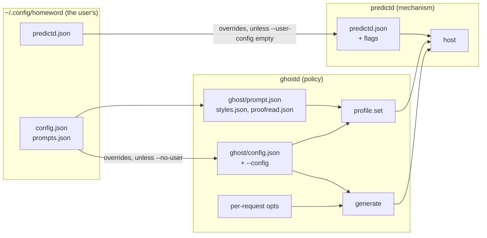

# Knobs

Knobs follow the mechanism/policy split ([ARCHITECTURE.md](ARCHITECTURE.md)):

| Layer | Where | What |
|---|---|---|
| Mechanism | `predictd.json`, daemon flags | how the host runs: socket, port, keep-alive, idle exit |
| Mechanism, per caller | `profile.set` and `generate` fields | what a client asks for: instructions, examples, schema, guardrails, token limit, sampling |
| Policy | `ghost/config.json`, `ghost/prompt.json`, `ghost/styles.json`, `ghost/proofread.json`, ghostd flags | how the policies use the model: context size, words, spell rules, the prompts per writing style and for proofreading |
| User | `~/.config/homeword/` | the user's overrides, outside the repo: `config.json` (policy knobs), `predictd.json` (daemon), `prompts.json` and `prompt-history.json` (their prompts, versions and benchmark results), `test-cases.json` (their benchmark cases) |

`pred status` prints the daemon's config, its profiles and the policy's config in effect.

**User overrides.** Both layers read the shipped file, then the user's file of the same name in `~/.config/homeword/`
(`$XDG_CONFIG_HOME/homeword/` if set) for the keys it contains. (The directory from before the project's rename is moved there on
first use.) Homeword's Engine tab writes the ports there (`serverPort` in `config.json`, `httpPort` in `predictd.json`) and its
General tab the words to suggest (`words`, `maxTokens`) and the writing languages (`languages`); any other knob works the same way. Benchmarks ignore the user's files
(`ghostd --no-user`, `predictd --user-config ""`).

## predictd.json (mechanism)

| Knob | Default | What it does |
|---|---|---|
| `keepAliveSec` | 3 | prewarm the pinned (or last used) session this often while idle; the cache expires after ~5-6 s. 0 = never |
| `keepAliveMaxIdleSec` | 300 | stop prewarming after this long without requests |
| `idleExitSec` | 1800 | exit after this long without requests; 0 = never |
| `cacheTTLSec` | 5.5 | after this long unused, a session's cache counts as `expired` in answers (reporting only) |
| `maxSessions` | 32 | sessions kept before the least recently used idle one is forgotten (never the pinned profile's) |
| `followRecentSec` | 30 | keep the session that generated last warm this long (an agent loop between turns), then the pinned profile |
| `httpPort` | 47320 | HTTP on 127.0.0.1; 0 = off. Restart to change |
| `socketPath` | /tmp/predictd-UID.sock | the unix socket (built-in default, not in predictd.json). Restart to change |

`reload` re-reads it without a restart (except the two listeners). Flags: `./predictd [--config path] [--socket path]
[--http-port n] [--version] [--model]` (`--model`: the system model's variant and context size, as JSON); the default config is
predictd.json next to the binary. A private daemon for experiments:
`./predictd --socket /tmp/my.sock --http-port 0`.

## Profile and generate fields (mechanism, chosen by each client)

| Field | In | Default | What it does |
|---|---|---|---|
| `instructions`, `examples` | profile | none | the system prompt and example turns: the cached prefix of every request |
| `schema` | profile, generate | none | JSON schema for structured answers (`generate` with `schema: true` uses the profile's) |
| `guardrails` | profile | default | `permissive` (`permissiveContentTransformations`) refuses less |
| `defaults` | profile | none | default generate fields for this profile, e.g. `{"maxTokens": 40}` |
| `maxTokens` | generate | the model's | output cap; the answer's `finish` is `length` when it was hit |
| `sampling` | generate | greedy | `greedy` (deterministic), `topK`, `topP` |
| `topK`, `topP`, `temperature`, `seed` | generate | 40, 0.9, model's, random | random sampling parameters (`temperature`, `seed` < 0 = unset) |
| `session`, `keep` | generate | default session, false | a named session, and whether it keeps its turns (conversation) |
| `stream` | generate | none | requests on one stream replace each other |
| `schemaInPrompt` | generate | false | also describe the schema in the prompt |

OpenAI-compatible requests (`/v1/chat/completions`) map onto the same fields: `max_tokens` → `maxTokens`, `temperature: 0` →
greedy, `top_p`/`seed` → `topP`/`seed`, `response_format` → `schema`, `tool_choice` → the tool-calling mode. See [OPENAI.md](OPENAI.md).

## ghost/config.json (policy)

| Knob | Shipped | What it does | Trade-off |
|---|---|---|---|
| `words` | 5 | words shown after the unfinished word; also fills `{words}` in the instructions. Homeword's General tab sets it (1-10) through `POST /settings`, with `maxTokens` = words + 1 per 5 words, in the user's overrides | more words = more output tokens (~16 ms each) and more wrong guesses |
| `maxTokens` | 6 | the model's output cap; a word cut by it is dropped | the biggest latency lever; raise with `words` |
| `textBudget` | 100 | tokens of typed text the model sees (the tail) | ~0.55 ms per cached token, ~2 ms uncached |
| `oneSentence` | true | stop the ghost at the end of the first sentence | |
| `invalidPolicy` | drop | `drop`: no ghost when the completed word is not a word; anything else shows it | |
| `lenientApps` | terminal, code | apps where words need not be dictionary words and the sentence rule is off | add labels for code-like input |
| `spellCheck`, `spellLanguage` | true, en | check completed words with predictd's `spell` op; `spellLanguage` for English text (other languages are checked in their own, or not at all without a macOS dictionary) | |
| `languages` | `[]` | the languages the user writes in (model locales: `de-DE`, `pt-BR`, `zh-Hant-TW`, ...); each request is detected among them. Empty: the system's language if the model supports it, else `en-US`; with `--no-user`, `en-US`. Homeword's General tab sets it through `POST /settings` | more languages = more chances to mistake one for a close one; one language skips detection |
| `languageLine` | `Language: {language}. Continue in {language}, not English.` | the line before `Text:` in requests whose text is not English (`{language}`: its English name) | a shorter line left more answers in English |
| `sampling`, `topK`, `topP`, `temperature`, `seed` | greedy, ... | passed to `generate` | greedy is the most accurate |
| `shots` | 6 | examples from prompt.json in the profile | each costs ~0.55 ms per token per request; fewer cost accuracy |
| `instructions` | short | `short` (`instructions_short`) or `long` (`instructions`) | short was faster and more accurate |
| `format` | suffix | `suffix`: the model writes the rest of the word; `fullword`: it rewrites the last word (`instructions_fullword`) | suffix is better |
| `output` | plain | `plain`, or `structured` (a one-field schema; shows off the mechanism) | structured is ~200 ms slower |
| `guardrails` | permissive | the profile's guardrails | |
| `serverPort`, `serverIdleExitSec` | 47321, 1800 | ghostd's HTTP port and idle exit | |
| `repeatNgram`, `repeatWindow` | 3, 60 | never complete a run of `repeatNgram` words already in the last `repeatWindow` words: the suggestion is cut before it (nothing shown: `suppressed: repetition`); 0 = off | stops the model echoing recent phrases, which loops when accepted again and again; also cuts an intended repeat |
| `userPrompts` | `~/.config/homeword/prompts.json` | the user's versions of the prompts (instructions and examples, typing per style and proofreading), edited in the Mac app or by `POST /prompts` | outside the repo; a changed prompt is a new profile, so the next request is uncached |
| `proofreadMaxInputTokens` | 2500 | the longest paragraph `/proofread` accepts (estimated tokens); a text is proofread one paragraph per request | the window is 8192: prefix + input + an answer of about the same length |
| `proofreadGuardrails` | permissive | the proofreading profiles' guardrails | `default` refuses more texts and is ~100 ms slower |

The proofreading prompts (instructions and examples per mode) are in `ghost/proofread.json`. Every prompt (each writing
style, proofread, rewrite; instructions and examples) can be overridden per user without touching the repo: `userPrompts` above,
edited in Homeword's Prompts tab or through `POST /prompts`.

## ghost/styles.json (policy)

The writing styles besides `general` (which is prompt.json): `title` (shown to users), `label` (the `App:` line), `shots` (its
examples, same format as prompt.json's; `app` optional, default the style's label) and optionally `instructions` (without, it uses
general's instructions). A style without `shots` uses general's whole prompt. Shipped, each chosen on the tuning cases
(`bench/styles-dev.json`) and checked on the held-out suite ([bench/RESULTS.md](../bench/RESULTS.md)): `email`, `work`, `academic`
with short instructions and 6 examples of their own; `chat` with general's instructions plus "The text is a casual chat message."
and 6 chat examples; `code` with general's instructions, four of its mixed examples and two code examples (6 code-only examples lost
4 of 25 cases). The benchmark suite: `bench/cases.json` + `bench/styles.json` (`run.py --styles`), at least 25 cases per category,
none of them in an example (`python3 -I bench/check_cases.py`; the benchmark also skips a case that shares text with an example
of the prompt it runs, e.g. a user's).

Every typing knob except `serverPort` and `serverIdleExitSec` (read when the server starts) also works per request:
`pred ask "text" --opts '{"words":8}'`, `pred try --opts ...`, or `opts` in a `/predict` request.
Knobs that change the prompt (`shots`, `instructions`, `format`, `output`, `guardrails`, `words`) make a different profile
(named by the hash of its content), registered on first use: the first request with them is uncached.

## ghost/prompt.json (policy)

| Field | What it is |
|---|---|
| `instructions_short` | the instructions used by default; `{words}` is replaced by `words` |
| `instructions`, `instructions_fullword` | the long variant and the one for `format: fullword` |
| `template` | the prompt for every request and every example: `App: {app}\nText: {text}` |
| `shots` | examples `{app, text, completion}`; the first `shots` of them are used, in order, so put the best first |

A `completion` follows the suffix format: for `"text": "I will send you the docu"` it is `"ment by the end of the day"`. The
`app` labels of the examples in the profile (the first `shots`: `mail`, `chat`, `notes`, `terminal`, `essay`) are the vocabulary
the model knows best; any other label works too (the integrations send `coding agent prompt`). Add examples when you add a new kind
of client. The prefix is ~280 tokens with 6 examples, paid on every request. After editing, restart ghostd (`pred stop`; the profile
name changes with the content) and re-run the benchmark ([PERFORMANCE.md](PERFORMANCE.md)).

## pred CLI

| Command | Flags |
|---|---|
| `pred try` | `--app auto\|terminal\|mail\|chat\|...`, `--debounce ms` (0), `--min-chars` (2), `--words` (prefetch extends the ghost up to this), `--opts '{...}'`, `--log file`, `--no-spawn` |
| `pred ask "text"` | `--app`, `--opts` |
| `pred serve` | `--port` (ghostd in the foreground) |
| `pred start`, `pred stop`, `pred status` | ghostd + predictd in the background |

`ghostd` itself: `--port N` (0 = any free port, named in the ready line on stdout), `--socket PATH` (predictd's), `--config JSON`
(policy overrides), `--no-user` (or `PRED_NO_USER=1`: without the user's config overrides and prompts), `--quiet`. One ghostd
per port: started while another answers on its port, it exits at once with status 0 ("already running").

## Integrations

| | Setting | Default |
|---|---|---|
| pi | env `GHOST_PORT`, `GHOST_APP`, `PRED_CLI` | 47321, `coding agent prompt`, the repo's `bin/pred` |
| Claude Code | constants `URL`, `APP` at the top of `hooks/register.ts` | `http://127.0.0.1:47321/predict`, `coding agent prompt` |
| Homeword (Mac app) | Settings window (UserDefaults domain `dev.homeword.app`): suggestions, pop-up position, minimum characters, Chrome-based browsers, proofreading and its shortcuts, a writing style per app; the built-in style tables in `app/Sources/Styles.swift`; words to suggest and ports in the user files above | see [app/README.md](../app/README.md) |

All three send at most the last 2000 characters; the policy trims further to `textBudget`.

## Recipes

| Goal | Change (ghost/config.json or `opts`) |
|---|---|
| Longer ghosts | `words: 8, maxTokens: 10` (about +65 ms) |
| Lowest latency | `words: 3, maxTokens: 4`, `shots: 4` (costs accuracy) |
| Multi-sentence | `oneSentence: false` |
| Variety instead of the single best guess | `sampling: "topP", topP: 0.9, temperature: 0.7` |
| Other languages | `languages: ["en-US", "fr-FR", "ja-JP"]` (or Homeword's General tab); one request in a known language: `language: "fr-FR"` in the `/predict` body |
| A code-like client | send `context: "code"` (the code writing style; its label `code` is in `lenientApps`: no dictionary or sentence rules) |
| Keep the cache warm longer | predictd.json `keepAliveMaxIdleSec` |
