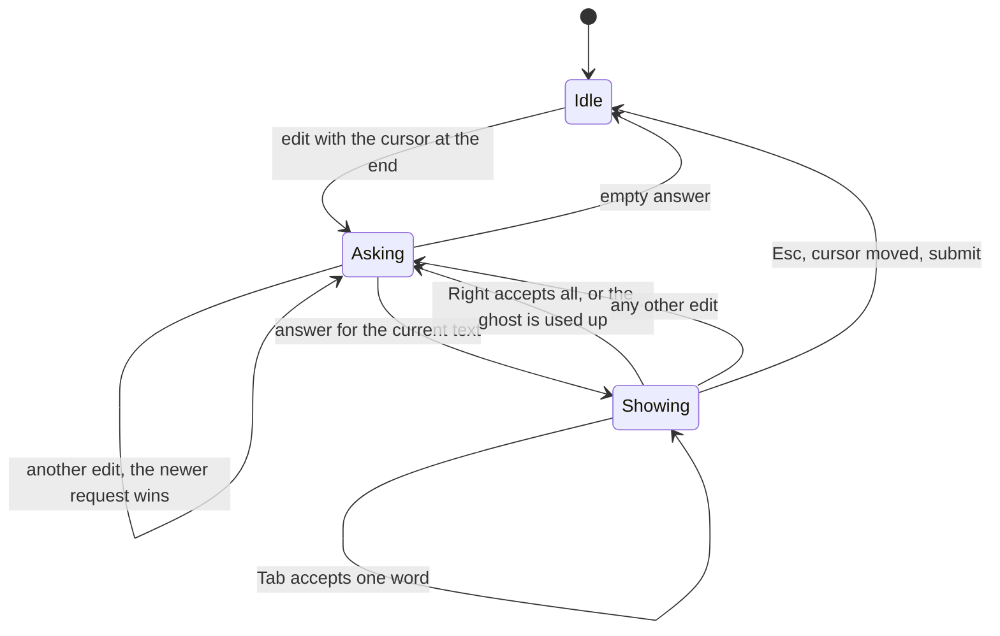
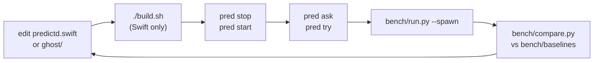

# Developing

Read [ARCHITECTURE.md](ARCHITECTURE.md) first, and [AGENTS.md](../AGENTS.md) for the repo rules. There are three kinds of work, one
per layer:

| You want to | Work in | Example |
|---|---|---|
| put ghost text into another app | an **application** on the ghost policy | a zsh widget, a Mac app, another agent's prompt box |
| run an agent or tool on the on-device model | nothing to build: point it at the **OpenAI-compatible API** | pi, the `openai` SDK, LangChain ([OPENAI.md](OPENAI.md)) |
| use the model for something other than typing prediction | a new **policy** on predictd | summarise a selection, write a commit message, triage |
| change what the model host can do | the **mechanism**, predictd | a new op, image input, tool calling in the native protocol |

Keep the rule: predictd never learns what its text is for. If a change needs predictd to know about words, keystrokes or apps, it
belongs in a policy; if every policy would need it (warm caches, cancelling, token limits), it belongs in predictd.

## Repo layout

```
predictd.swift  predictd.json   mechanism: the model host (profiles, sessions, generate, keep-alive, socket + HTTP)
build.sh                        swiftc -O -> ./predictd (git-ignored)
ghost/                          policy: the typing predictor (Python, standard library only)
  predictd.py                     generic client for predictd, reusable by any Python policy
  policy.py                       profile from prompt.json, trim, generate, assemble
  server.py                       HTTP front end for non-Python apps (127.0.0.1:47321)
  config.json  prompt.json        policy knobs and prompt
bin/pred                        CLI: try, ask, serve, start, stop, status
integrations/pi/                application: pi extension (TypeScript)
integrations/claude-code/       application: Claude Code mod (TypeScript)
bench/                          benchmarks of the ghost policy, cases, baselines, RESULTS.md
docs/                           these documents
```

## An application on the ghost policy

An application turns keystrokes into ghost requests and answers into dim text. The policy and the mechanism do the hard parts
(prompting, caching, cancelling, spelling, word and sentence limits), so each sample application is under 200 lines.

### The contract

1. **Ask on every edit**, with no debounce, while the cursor is at the end of the text: `POST 127.0.0.1:47321/predict` with
   `text` = everything before the cursor, an `app` label and a `stream` naming the input field. A newer request on the stream
   cancels the running one for free; the cancelled one answers `{"ok":false,"error":"cancelled"}`: drop it. Also drop any answer
   for a text that is no longer current.
2. **Show `suggestion` verbatim** after the cursor, dimmed. It carries its leading space when one is needed; `""` = no ghost.
3. **Follow the ghost**: when the user types the ghost's next character, shorten the ghost instead of asking again.
4. **Accept**: Tab inserts the first word (up to and including it, e.g. `" the"` or `"ing"`) and keeps the rest; → inserts all.
   When the ghost is used up, ask again.
5. **Clear** on any other edit, on Esc, when the cursor leaves the end, and on submit.



Skip what is not prose for your `app`: both integrations ignore `/commands`, `!shell` lines and texts under 2 characters. If nothing
answers on 47321, run `bin/pred start` and show nothing meanwhile.

```sh
curl -s 127.0.0.1:47321/predict -d '{"app":"chat","text":"See you tomor","stream":"demo"}'
# {"ok":true,"suggestion":"row for coffee at the","first_word":"tomorrow","partial":"tomor",...}
```

Python applications can skip HTTP and use the policy directly, as `pred try` does:

```python
from ghost import predictd
from ghost.policy import Ghost
ghost, link = Ghost(), predictd.start()
ghost.ensure_profile(link, pin=True)
print(ghost.predict(link, "chat", "See you tomor")["suggestion"])   # row for coffee at the
```

### The two sample applications

| | pi | Claude Code |
|---|---|---|
| Extension point | `ctx.ui.setEditorComponent`: a `CustomEditor` subclass replaces the prompt editor | a mod: `prompt.edit` hook sees every edit |
| Request | `fetch` with an `AbortController` | `$.http.fetch` from a `$.clock.after` timer, so typing is never held up |
| Drawing | `render()` writes the ghost into the editor's fake cursor cell and the padding after it | `$.prompt.fill` with a dim `virtualText` decoration at the end of the draft |
| Keys | `handleInput` sees Tab and → first | Tab and → at the end of the draft never reach a hook: they are bound to two slash commands in keybindings.json |
| Source | [integrations/pi](../integrations/pi/README.md) | [integrations/claude-code](../integrations/claude-code/README.md) |

Both send `app: "coding agent prompt"`, which is not an example label: the model treats it as chat-like prose.

### Ideas for the next applications

- **Shell (zsh)**: a ZLE widget on `self-insert` showing the answer as `POSTDISPLAY` (fish-style). Shells already complete commands,
  so the value is in commit messages, quoted strings and comments; send `app: "terminal"` (the prompt has a few `terminal` examples; add more).
- **Other terminal agents**: anything with a prompt-editor hook works like the samples. Codex has no extension point for its prompt
  box today (it would need a patch).
- **System-wide Mac app**: a menu bar app reads the focused text field and caret through the Accessibility API, draws the ghost in a
  borderless overlay window and accepts with a global key, or an input method (InputMethodKit). Open questions: Accessibility
  permission, conflicts with macOS's own inline predictions and autocorrect, and whether the on-device model may be used at all on
  a managed Mac (check the policy first).

## A new policy on predictd

A policy registers its own profile and calls `generate`; it shares the daemon (and the warm cache) with the ghost policy. Any
language works: the socket protocol is one JSON object per line, and `ghost/predictd.py` is a ready Python client.

```python
from ghost import predictd
link = predictd.start()
link.call(op="profile.set", name="commit-msg", instructions="Write a one-line git commit message for the diff.",
          examples=[{"prompt": "- retries = 3\n+ retries = 5", "response": "Raise the retry count to 5"}], defaults={"maxTokens": 24})
print(link.call(op="generate", profile="commit-msg", prompt=diff)["text"])
```

```zsh
# plain zsh, no tools: the start of a shell policy
zmodload zsh/net/socket
zsocket /tmp/predictd-$UID.sock
print -r -- '{"op":"generate","id":"1","profile":"commit-msg","prompt":"..."}' >&$REPLY
read -r line <&$REPLY; print -r -- $line
```

Things to decide in a policy, not in predictd:

- **Which profile to pin.** Only one prefix stays warm in the whole system. The typing predictor pins its profile because it needs
  ~250 ms answers; an occasional policy (a summariser) should not pin, and pays one uncached prefix (~2 ms per token) per switch.
- **Plain or structured.** Give the profile a `schema` and its examples as JSON objects, then `generate` with `schema: true`; the
  answer's `content` is parsed JSON. Structured answers cost ~200 ms more than plain ones for very short outputs.
- **Stateless or conversation.** The default session forgets each request (fast, cached). A named session with `keep: true` keeps
  its turns; `session.drop` ends it.
- **Cancelling.** Send interactive requests with a `stream`; a newer one replaces the older.
- **The token limit and sampling** per request (`maxTokens`, `sampling`, ...), or once in the profile's `defaults`.
- **Re-registering.** predictd starts with no profiles and exits when idle: on `unknown_profile`, send `profile.set` again and
  retry (`profile.set` with an unchanged definition is free and keeps the warm session).

## Changing the mechanism

### Development loop



Policy edits (ghost/*.py, config.json, prompt.json) need no build: restart the `pred` process using them. Try knobs without editing
files: `pred ask "text" --opts '{...}'`, or `python3 -I bench/run.py --spawn --config '{...}'` (policy) and `--daemon-config '{...}'`
(daemon). Benchmark rules (nothing else using the model, compare within one model mode) are in AGENTS.md; scenarios and metrics are
in [PERFORMANCE.md](PERFORMANCE.md).

### Where things are in predictd.swift

| Section (`// MARK:`) | What is there |
|---|---|
| config | `Config`: the daemon knobs (`apply` reads JSON, `dict` is reported by `stats`) |
| schemas | JSON Schema subset → `DynamicGenerationSchema`; `hitTokenCap` (the finish reason) |
| profiles and sessions | `Profile` (definition → transcript), `Slot` (one session, its base transcript and queue) |
| engine | `Engine`: keep-alive, `options`, `generate`, `handle` (every op) |
| OpenAI-compatible API | `parseChat` (messages → transcript, options), `chat`/`runChat` (sessions, streaming, tool-call capture) |
| socket server, HTTP | listeners; `main` parses the flags |

### Adding a knob

- **Daemon-wide** (how the host runs): a `Config` field, read in `apply`, reported in `dict`, a value in predictd.json, a row in
  CONFIG.md.
- **Per request** (what a caller asks for): read it from the merged request in `Engine.generate` (`r`, which already includes the
  profile's `defaults`), and add it to the profile/generate table in CONFIG.md.
- **Policy** (how the typing predictor behaves): a key in ghost/config.json used in `ghost/policy.py`, and a row in CONFIG.md.

If it can change latency or quality, run the benchmark before and after and say so in the commit.

### Adding an op

Add a `case` to `Engine.handle` and answer with `conn.send([...])` including the request's `id`. HTTP clients get it for free (any
`POST` body is handled the same way). Document it in the protocol table in ARCHITECTURE.md and, if useful, wrap it in
`ghost/predictd.py`.

## Testing

- `python3 -I bench/try_pty_test.py`: drives `pred try` through a pty (smoke test of policy + mechanism).
- `python3 -I bench/run.py --spawn`: the fixed benchmark; quality numbers must not drop without a reason.
- Integrations: run the real app in tmux and measure with `bench/integration_latency.py` (see its docstring). Test Claude Code with
  a throwaway `CLAUDE_CONFIG_DIR` holding the keybindings, never by editing `~/.claude/keybindings.json`.
- `claude plugin validate integrations/claude-code` after changing the mod.
- `python3 -I bench/openai_compare.py`: the OpenAI-compatible API against the native protocol (latency, identical outputs, bursts).
