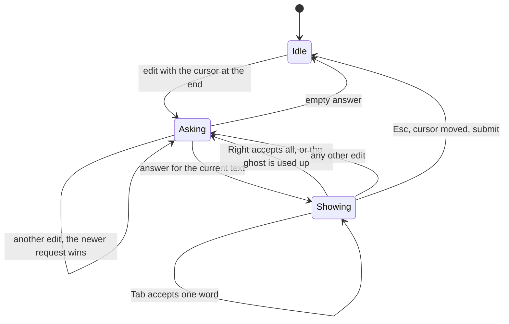
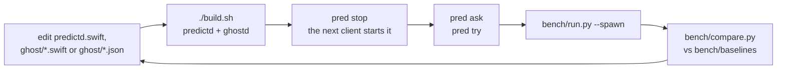

# Developing

Read [ARCHITECTURE.md](ARCHITECTURE.md) first, and [AGENTS.md](../AGENTS.md) for the repo rules. There are three kinds of work, one
per layer:

| You want to | Work in | Example |
|---|---|---|
| put ghost text into another app | an **application** on the ghost policy | a zsh widget, a Mac app, another agent's prompt box |
| run an agent or tool on the on-device model | nothing to build: point it at the **OpenAI-compatible API** | pi, the `openai` SDK, LangChain ([OPENAI.md](OPENAI.md)) |
| use the model for something other than typing prediction | a new **policy** on predictd | summarise a selection, write a commit message, triage |
| change what the model host can do | the **mechanism**, predictd | a new op, image input, tool calling in the native protocol |

Keep the rule: predictd never learns what its text is for. If a change needs predictd to know about words, keystrokes or apps, it
belongs in a policy; if every policy would need it (warm caches, cancelling, token limits), it belongs in predictd.

## Repo layout

```
predictd.swift  predictd.json   mechanism: the model host (profiles, sessions, generate, keep-alive, socket + HTTP)
build.sh                        swiftc -O -> ./predictd and ./ghostd (git-ignored)
ghost/                          policies (Swift) -> ./ghostd: typing prediction, proofreading, their HTTP server (127.0.0.1:47321)
  Policy.swift                    typing: profiles per writing style, trim, generate, assemble, warm
  Proofread.swift                 proofreading: fix or rewrite a text, paragraph by paragraph, word diff
  Prompts.swift                   the user's prompts, their history and benchmark results (outside the repo)
  Evaluate.swift                  scoring and per-style benchmarks (POST /bench, run.py --styles)
  Predictd.swift                  predictd client (unix socket), starts predictd
  PyCompat.swift                  text, JSON and hash helpers (the policy was first written in Python and keeps its semantics)
  main.swift                      startup: flags, the port, predictd, the accept loop; the route list
  Routes.swift                    the routes, the predictd connection pool, the HTTP server
  Selftest.swift                  ghostd --selftest: the pure functions on JSON lines (no model), for checks
  config.json  prompt.json        policy knobs and the general prompt
  styles.json  proofread.json     the other writing styles (chat, email, work, academic, code), the proofreading prompts
bin/pred                        CLI (Python, a client of ghostd): try, ask, serve, start, stop, status
integrations/pi/                application: pi extension (TypeScript)
integrations/claude-code/       application: Claude Code mod (TypeScript)
app/                            application: Homeword, menu bar Mac app, system-wide suggestions and proofreading (Swift)
bench/                          benchmarks (Python, clients of ghostd), cases, baselines, RESULTS.md
docs/                           these documents
```

## An application on the ghost policy

An application turns keystrokes into ghost requests and answers into dim text. The policy and the mechanism do the hard parts
(prompting, caching, cancelling, spelling, word and sentence limits), so each sample application is under 200 lines.

### The contract

1. **Ask on every edit**, with no debounce, while the cursor is at the end of the text: `POST 127.0.0.1:47321/predict` with
   `text` = everything before the cursor, an `app` label and a `stream` naming the input field. A newer request on the stream
   cancels the running one for free; the cancelled one answers `{"ok":false,"error":"cancelled"}`: drop it. Also drop any answer
   for a text that is no longer current.
2. **Show `suggestion` verbatim** after the cursor, dimmed. It carries its leading space when one is needed; `""` = no ghost.
3. **Follow the ghost**: when the user types the ghost's next character, shorten the ghost instead of asking again.
4. **Accept**: Tab inserts the first word (up to and including it, e.g. `" the"` or `"ing"`) and keeps the rest; → inserts all.
   When the ghost is used up, ask again.
5. **Clear** on any other edit, on Esc, when the cursor leaves the end, and on submit.



Skip what is not prose for your `app`: both integrations ignore `/commands`, `!shell` lines and texts under 2 characters. If no ghostd
answers on 47321, start the repo's `ghostd` in the background (it starts predictd; the pi extension and Homeword do this) and show
nothing meanwhile. Never start one while one answers; if two apps race, the second ghostd finds the port taken and exits at once,
before it touches predictd.

**Is ghostd running?** `GET 127.0.0.1:47321/health` (the port: `serverPort` in ghost/config.json and the user's overrides):

```sh
curl -s 127.0.0.1:47321/health
# {"ok":true,"service":"ghostd","version":"0.1.0","build":"2026-11-11T23:51:37Z","pid":82640,"started":"2026-11-11T23:52:11Z",
#  "port":47321,"model":true,"availability":"available"}
```

Running = the answer has `ok: true` and `service: "ghostd"` (anything else on the port, or predictd's own `/health`, says
otherwise or nothing). Connection refused = not running; no answer within a few seconds = probably starting (it takes the port
first, then answers once predictd is up): wait instead of starting another. `model`: predictd answers; `availability`: whether the
on-device model can be used (`available`, `apple_intelligence_off`, `model_not_ready`, `device_not_eligible`). `build` is when the
running binary was built (its modification time): compare it with the binary on disk to find a ghostd started before a rebuild.
`version` is the project's VERSION, `started` when the process started.

```sh
curl -s 127.0.0.1:47321/predict -d '{"app":"chat","text":"See you tomor","stream":"demo"}'
# {"ok":true,"suggestion":"row for coffee at the","first_word":"tomorrow","partial":"tomor",...}
```

`pred try` is a full Python client (threads for the blocking requests, a stream per session); `bench/engine.py` has the helpers.

### The sample applications

| | pi | Claude Code | Homeword (Mac app) |
|---|---|---|---|
| Extension point | `ctx.ui.setEditorComponent`: a `CustomEditor` subclass replaces the prompt editor | a mod: `prompt.edit` hook sees every edit | none: Accessibility reads the focused field of any app, a session event tap sees every key |
| Request | `fetch` with an `AbortController` | `$.http.fetch` from a `$.clock.after` timer, so typing is never held up | `URLSession`; the field is re-read before showing, so an answer for stale text is dropped |
| Drawing | `render()` writes the ghost into the editor's fake cursor cell and the padding after it | `$.prompt.fill` with a dim `virtualText` decoration at the end of the draft | a borderless, non-activating panel below or next to the caret rect (`AXBoundsForRange`) |
| Keys | `handleInput` sees Tab and → first | Tab and → at the end of the draft never reach a hook: they are bound to two slash commands in keybindings.json | the event tap consumes Tab and Esc while a suggestion shows; accepted words are typed as synthetic key events |
| Source | [integrations/pi](../integrations/pi/README.md) | [integrations/claude-code](../integrations/claude-code/README.md) | [app](../app/README.md) |

pi and Claude Code send `app: "coding agent prompt"` and no style (general), which is not an example label: the model treats it as
chat-like prose. Homeword sends a writing style (`context`) picked per app and per web app (`app/Sources/Styles.swift`), warms it
on app switch (`POST /warm`), uses the proofreading policy (`POST /proofread`) on the selection, edits and benchmarks prompts
(`/prompts`, `/tokens`, `/bench`, `/history`, `/suite`, `/cases`), sets the words to suggest and the writing languages
(`/settings`), and logs usage metrics (counts and timings, no text) that `bench/app_metrics.py` summarises. Its interface texts go
through `L()` and are translated into 17 languages ("Interface languages" in [app/README.md](../app/README.md)). An application
that knows the text's language can send `language` with `/predict`; otherwise the engine detects it among the user's
`languages`.

### Ideas for the next applications

- **Shell (zsh)**: a ZLE widget on `self-insert` showing the answer as `POSTDISPLAY` (fish-style). Shells already complete commands,
  so the value is in commit messages, quoted strings and comments; send `app: "terminal"` (the prompt has a few `terminal` examples;
  add more).
- **Other terminal agents**: anything with a prompt-editor hook works like the samples. Codex has no extension point for its prompt
  box today (it would need a patch).
- **Homeword, next steps**: inline ghost text instead of a pop-up needs an input method (InputMethodKit), which owns the marked text
  in every app; more benchmark cases per style (25 is still coarse: one case is 4 points); tuning from the collected metrics
  (acceptance by style and app, latency tail). Still open: whether the on-device model may be used on a managed Mac (check the
  policy first).

## A new policy on predictd

A policy registers its own profile and calls `generate`; it shares the daemon (and the warm cache) with the ghost policy. Any
language works: the socket protocol is one JSON object per line, and predictd's HTTP port takes the same objects as POST bodies.
`ghost/Proofread.swift` is a complete second policy: one unpinned profile per mode, one `generate` sized to the input, clean-up of
the answer, a word diff, and an HTTP route in `ghost/Routes.swift`. A new policy can live in ghostd the same way, or be its own
program in any language:

```python
import json, urllib.request
def call(**req):           # predictd over HTTP (127.0.0.1:47320); the unix socket takes the same JSON, one object per line
    return json.load(urllib.request.urlopen("http://127.0.0.1:47320/", json.dumps(req).encode()))
call(op="profile.set", name="commit-msg", instructions="Write a one-line git commit message for the diff.",
     examples=[{"prompt": "- retries = 3\n+ retries = 5", "response": "Raise the retry count to 5"}], defaults={"maxTokens": 24})
print(call(op="generate", profile="commit-msg", prompt=diff)["text"])
```

```zsh
# plain zsh, no tools: the start of a shell policy
zmodload zsh/net/socket
zsocket /tmp/predictd-$UID.sock
print -r -- '{"op":"generate","id":"1","profile":"commit-msg","prompt":"..."}' >&$REPLY
read -r line <&$REPLY; print -r -- $line
```

Things to decide in a policy, not in predictd:

- **Which profile to pin.** Only one prefix stays warm in the whole system. The typing predictor pins its profile because it needs
  ~250 ms answers; an occasional policy (a summariser) should not pin, and pays one uncached prefix (~2 ms per token) per switch.
- **Plain or structured.** Give the profile a `schema` and its examples as JSON objects, then `generate` with `schema: true`; the
  answer's `content` is parsed JSON. Structured answers cost ~200 ms more than plain ones for very short outputs.
- **Stateless or conversation.** The default session forgets each request (fast, cached). A named session with `keep: true` keeps
  its turns; `session.drop` ends it.
- **Cancelling.** Send interactive requests with a `stream`; a newer one replaces the older.
- **The token limit and sampling** per request (`maxTokens`, `sampling`, ...), or once in the profile's `defaults`.
- **Re-registering.** predictd starts with no profiles and exits when idle: on `unknown_profile`, send `profile.set` again and
  retry (`profile.set` with an unchanged definition is free and keeps the warm session).

## Changing the engine (predictd, ghostd)

### Development loop



Policy edits: `./build.sh` after changing ghost/*.swift; the JSON files (config.json, prompt.json, styles.json, proofread.json)
need no build. Either way restart the engine (`pred stop`; Homeword, pi or the next `pred` command starts it again; Homeword's
Engine tab also has Restart). Try knobs without editing files: `pred ask "text" --opts '{...}'`, or `python3 -I bench/run.py
--spawn --config '{...}'` (policy) and `--daemon-config '{...}'` (daemon). Benchmark rules (nothing else using the model, compare
within one model mode) are in AGENTS.md; scenarios and metrics are in [PERFORMANCE.md](PERFORMANCE.md).

### Where things are in predictd.swift

| Section (`// MARK:`) | What is there |
|---|---|
| config | `Config`: the daemon knobs (`apply` reads JSON, `dict` is reported by `stats`) |
| schemas | JSON Schema subset → `DynamicGenerationSchema`; `hitTokenCap` (the finish reason) |
| profiles and sessions | `Profile` (definition → transcript), `Slot` (one session, its base transcript and queue) |
| engine | `Engine`: keep-alive, `options`, `generate`, `handle` (every op) |
| OpenAI-compatible API | `parseChat` (messages → transcript, options), `chat`/`runChat` (sessions, streaming, tool-call capture) |
| socket server, HTTP | listeners; `main` parses the flags |

### Where things are in ghost/ (ghostd)

| File | What is there |
|---|---|
| `main.swift` | the flags; claiming the port (one ghostd per port) and `/health`'s identity; starting predictd; the idle watchdog and the accept loop; the route list (header comment) |
| `Routes.swift` | the predictd connection pool (`withLink`: reconnect and re-register when predictd went away); prompt names (`predict-<style>`, `proofread-<mode>`); benchmark jobs; the routes (`handleGET`, `handlePOST`); the HTTP server (`serve`). Kept out of main.swift: Swift treats main.swift's functions as part of its top-level code, so calling them from the per-connection queue needs `@Sendable` all the way down |
| `Policy.swift` | typing: text rules (unfinished word, sentence ends, repetition cut), `Speller`, `assemble`; config loading with the user's overrides; `Ghost`: styles, profiles, `request`/`finish`/`predict`, `warm` |
| `Proofread.swift` | `Proofreader`: prompts from proofread.json, a profile per mode, one request per paragraph; the word diff (`SequenceMatcher`) |
| `Prompts.swift` | the user's prompts, history, benchmark results and cases (files in `~/.config/homeword/`) |
| `Evaluate.swift` | the benchmark suite, scoring, the overlap rule, `benchPrompt`, `benchProofread` |
| `Predictd.swift` | `Link` (the unix-socket client), `startPredictd`, `spawnDetached`, `ROOT` (where the data files are) |
| `PyCompat.swift` | Python's string and JSON semantics, which the policy keeps (code points, character classes, `json.dumps`) |
| `Selftest.swift` | `ghostd --selftest`: the pure functions on JSON lines, no model |

### Adding a knob

- **Daemon-wide** (how the host runs): a `Config` field, read in `apply`, reported in `dict`, a value in predictd.json, a row in
  CONFIG.md.
- **Per request** (what a caller asks for): read it from the merged request in `Engine.generate` (`r`, which already includes the
  profile's `defaults`), and add it to the profile/generate table in CONFIG.md.
- **Policy** (how the typing predictor behaves): a key in ghost/config.json used in `ghost/Policy.swift`, and a row in CONFIG.md.

If it can change latency or quality, run the benchmark before and after and say so in the commit.

### Adding an op

Add a `case` to `Engine.handle` and answer with `conn.send([...])` including the request's `id`. HTTP clients get it for free (any
`POST` body is handled the same way). Document it in the protocol table in ARCHITECTURE.md.

### Adding a ghostd route

A `case` in `handleGET` or `handlePOST` (`ghost/Routes.swift`) answering a JSON object with `ok`; a client error is a thrown
`ClientError` (HTTP 400 with its message). List it in the header comment of main.swift and in ARCHITECTURE.md. Clients: Homeword
(`Services.post`/`get`), the integrations (`fetch`), the Python tools (`bench/engine.py` `http`).

## Testing

- `python3 -I bench/try_pty_test.py`: drives `pred try` through a pty (smoke test of policy + mechanism).
- `python3 -I bench/run.py --spawn`: the fixed benchmark; quality numbers must not drop without a reason.
- `python3 -I bench/check_cases.py`: no prompt example appears in the benchmark or tuning cases (after editing either).
- `python3 -I bench/run.py --spawn --styles`: every writing style's prompt on the suite, per category (after changing a prompt).
- Integrations: run the real app in tmux and measure with `bench/integration_latency.py` (see its docstring). Test Claude Code with
  a throwaway `CLAUDE_CONFIG_DIR` holding the keybindings, never by editing `~/.claude/keybindings.json`.
- `claude plugin validate integrations/claude-code` after changing the mod.
- `python3 -I bench/openai_compare.py`: the OpenAI-compatible API against the native protocol (latency, identical outputs, bursts).
