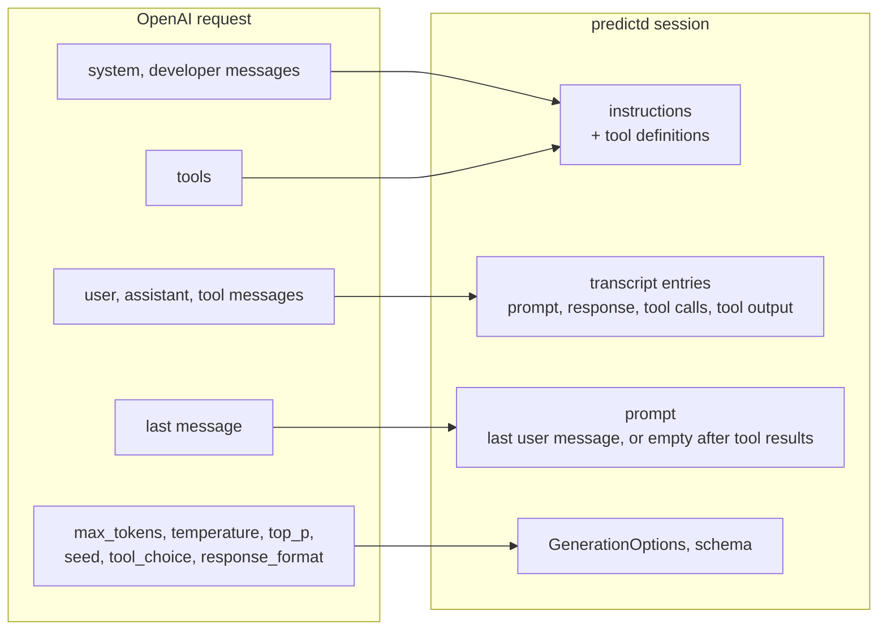
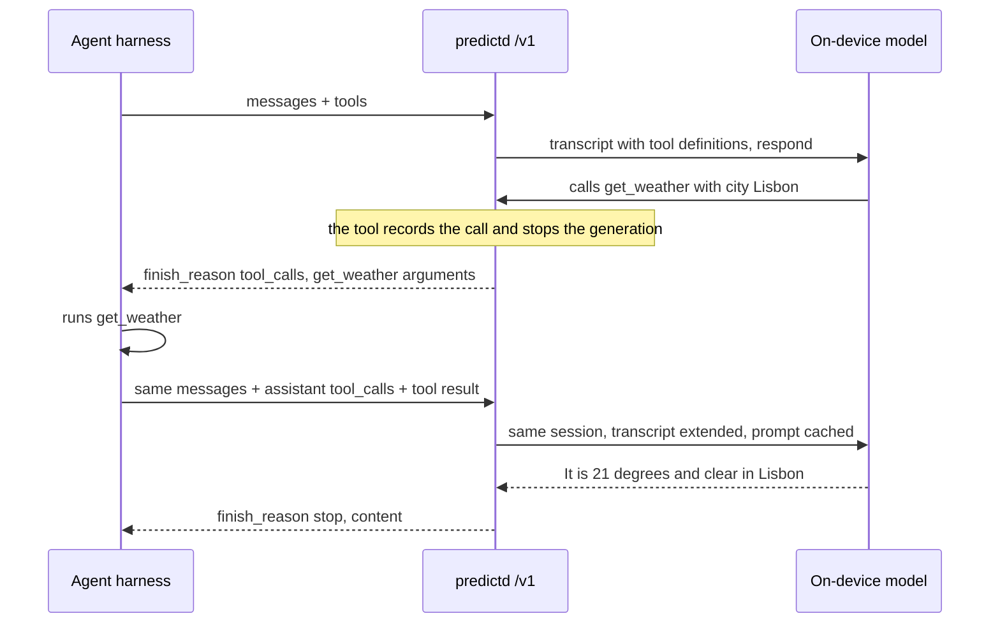

# OpenAI-compatible API

predictd serves an OpenAI-style chat API on its HTTP port, so any agent harness, SDK or tool that can talk to an OpenAI-compatible
endpoint can use Apple's on-device model:

```
base URL   http://127.0.0.1:47320/v1
API key    anything (it is ignored; many clients require one, e.g. "local")
models     apple-on-device, apple-on-device-permissive, and every registered profile
```

It is part of the mechanism layer ([ARCHITECTURE.md](ARCHITECTURE.md)): a translation of OpenAI requests onto predictd's sessions,
with no policy of its own. predictd runs while the engine does (Homeword or `bin/pred start` start it through ghostd), or start it
alone with `./predictd`; it exits after 30 idle minutes.

```sh
curl -s 127.0.0.1:47320/v1/chat/completions -H 'Content-Type: application/json' -d '{
  "model": "apple-on-device",
  "messages": [{"role": "system", "content": "You are terse."}, {"role": "user", "content": "Name three primary colors."}]
}'
# {"object":"chat.completion","choices":[{"message":{"role":"assistant","content":"Red, blue, yellow."},"finish_reason":"stop",...}],
#  "usage":{"prompt_tokens":65,"completion_tokens":13,"total_tokens":78,"prompt_tokens_details":{"cached_tokens":0}},...}
```

## Connecting a harness

**Python, the `openai` package**

```python
from openai import OpenAI
client = OpenAI(base_url="http://127.0.0.1:47320/v1", api_key="local")
r = client.chat.completions.create(model="apple-on-device", messages=[{"role": "user", "content": "Hello!"}])
print(r.choices[0].message.content)
```

**pi** (`~/.pi/agent/models.json`, then `pi --model apple/apple-on-device`), tested with tool calls:

```json
{
  "providers": {
    "apple": {
      "baseUrl": "http://127.0.0.1:47320/v1",
      "api": "openai-completions",
      "apiKey": "local",
      "models": [{ "id": "apple-on-device", "name": "Apple on-device", "contextWindow": 16384, "maxTokens": 1024 }]
    }
  }
}
```

The real window is 8192 tokens, but pi estimates this model's tokens at about twice the real count and then leaves itself no room to
answer (it sent `max_completion_tokens: 1`). Declaring 16384 fixes that; predictd still answers `context_length_exceeded` when a
conversation really does not fit. Also set a small compaction reserve in pi's settings (`{"compaction": {"reserveTokens": 1024}}`).

**Other clients** (LangChain, LlamaIndex, Continue, aider, opencode, ...): choose their "OpenAI-compatible" provider and set the base
URL, any key and the model id above.

## How a request is translated



- One session per model and tool set. Each request replaces its transcript with the request's messages; consecutive turns of one
  conversation extend it, so they reuse the prefix cache (`usage.prompt_tokens_details.cached_tokens`).
- A model that is a registered profile adds the profile's instructions (before the system messages) and its example turns.
- Requests on the same session run one at a time; requests from different sessions share the one model.

## Tool calls

predictd never runs tools. When the model calls one, the call goes back to the caller as OpenAI `tool_calls`; the caller runs it and
sends the result in the next request, exactly as with OpenAI:



`tool_choice`: `auto` (default), `none`, `required`, or `{"type": "function", "function": {"name": ...}}` (only that tool, required).
Tool parameter schemas may use objects, arrays, enums, `anyOf`/`oneOf` and nullable types; anything else is generated as a string.

## Supported parameters

| Parameter | Support |
|---|---|
| `model` | `apple-on-device` (default guardrails), `apple-on-device-permissive`, or a profile name |
| `messages` | roles `system`, `developer`, `user`, `assistant` (with `tool_calls`), `tool`; text content (string or text parts) |
| `tools`, `tool_choice` | function tools, see above |
| `stream`, `stream_options.include_usage` | server-sent events in OpenAI's chunk format; text arrives in chunks of a few dozen tokens |
| `max_tokens`, `max_completion_tokens` | output cap; `finish_reason: "length"` when hit |
| `temperature` | `0` = greedy (deterministic); otherwise passed to the model |
| `top_p`, `seed` | nucleus sampling with an optional seed |
| `response_format` | `json_schema` (constrained generation, same schema subset as tools); `json_object` (instruction only) |
| `stop` | applied to the output (the model may generate a little past it) |
| `reasoning_effort` | accepted and ignored: the on-device model has no reasoning mode |
| `n` | 1 only |
| images, audio, `logprobs`, the Responses API (`/v1/responses`), embeddings | not supported |

Errors use OpenAI's shape (`{"error": {"message", "type", "code"}}`): 404 `model_not_found`, 404 `not_found` for other paths,
400 `context_length_exceeded`, 400 for invalid requests, 429 when the system is busy, 500 otherwise. With `stream: true`, an error
during generation arrives as a `data: {"error": ...}` event in the (already started, status 200) stream. Content blocked by Apple's
guardrails returns `finish_reason: "content_filter"` with empty content. `GET /v1/models/{id}` describes one model.

## Limits and performance (Apple M4 Pro, macOS 27.2)

- **Context window: 8192 tokens** for everything: system prompt, tools, history and answer. Large harness prompts eat most of it
  (pi's system prompt and two tools: ~4,400 tokens). Keep system prompts small, and enable the harness's compaction.
- **Latency is dominated by prompt length**: ~0.75 ms per prompt token even when cached, plus ~20 ms per output token. A ~4,100-token
  prompt takes ~3.1 s before the first word; with tools defined, a turn of a pi-sized prompt took 5-8 s. Short prompts answer in
  well under a second.
- **The translation costs nothing.** The typing workload through `/v1/chat/completions` (permissive model, same examples as
  messages, or the typing profile as the model) gave the same outputs (40/40) and the same latency as the native `generate` op and
  the typing policy's `/predict` (370, 375 and 377 ms p50). `apple-on-device` (default guardrails) is ~100 ms slower per request
  than `apple-on-device-permissive`, with the same outputs on these cases. Re-measure with `bench/openai_compare.py`.
- **No cancellation.** OpenAI requests have no "newest wins": a burst of 12 keystroke requests 40 ms apart took 3.1 s to answer the
  last one, against 0.34-0.36 s with the native protocol's or `/predict`'s `stream`. Keystroke-rate clients (ghostd) use the
  native protocol.
- **One model for the whole machine.** The typing predictor, other policies and API calls share it. predictd keeps the most recent
  session warm for `followRecentSec` (30 s) so an agent loop keeps its cache between turns, then returns to the pinned profile.
- Usage of a turn that ends in tool calls is approximate: `prompt_tokens` counts the transcript without the last prompt, cached and
  completion tokens are 0 (the framework does not report usage for an interrupted generation).
- No authentication: like the socket, the port is for the local user's processes. It listens on 127.0.0.1 only.
