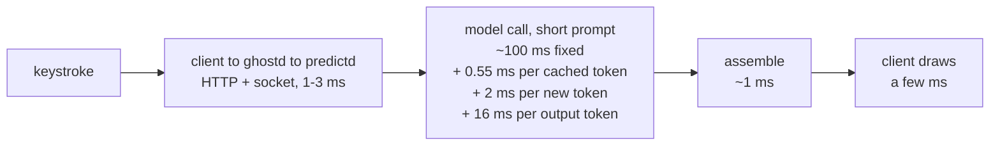

# Performance: benchmarks and latency

Full results per machine, with the raw data: [bench/RESULTS.md](../bench/RESULTS.md). Every table below names the machine it was
measured on; results show the best run per machine.

## Summary

| Measurement | Apple M4 Pro, macOS 27.2 | Apple M4 Max, macOS 27.0.1 | Apple M1 Pro, macOS 27.2.1 | Apple M2, macOS 27.2.1 |
|---|---|---|---|---|
| Model (`predictd --model`) | AFM 3 Core Advanced | AFM 3 Core Advanced | AFM 3 Core | AFM 3 Core |
| Context window (`predictd --model`) | 8,192 tokens | 8,192 tokens | 4,096 tokens | 8,192 tokens |
| Steady benchmark, p50 / p90 (`bench/run.py`) | 329 / 426 ms | 295 / 408 ms | 500 / 632 ms | 286 / 357 ms |
| Typing simulation, key → ghost p50 / p90 (`bench/human_pty.py`) | 259 / 284 ms | 258 / 291 ms | 352 / 419 ms | 256 / 412 ms |
| pi extension, last keystroke → ghost on screen p50 (`bench/integration_latency.py`) | 117 ms | not measured | not measured | not measured |
| Claude Code mod, last keystroke → ghost on screen p50 | 157 ms | not measured | not measured | not measured |

The M4 Macs and the M1/M2 Macs run different versions of the model (bench/RESULTS.md, "Model variants"), so latency across those
columns compares a Mac with its own model, and quality numbers compare only within one model. The context window depends on the chip,
not on the model (bench/RESULTS.md, Machines); the typing prompts (~300 tokens) fit either. The rows measure different things. The steady benchmark sends unrelated texts, so only the prompt prefix is cached. While typing,
the previous keystroke's text is cached too. In the integration runs, the ghost from an earlier keystroke often still fits and is
shown again without a new request (follow-the-ghost); a fresh model call never takes under ~250 ms.

Where the time of one keystroke goes (Apple M4 Pro, short typing prompt):



## How the benchmarks work

The benchmarks measure the typing policy on predictd end to end: `run.py` starts a private predictd and a private ghostd
(`--no-user`) and sends its requests over HTTP, so a run covers both layers (a change in either shows up). `bench/run.py`
scenarios: `steady` (1.2 s between requests), `burst` (back to back), `idle` (15 s gaps: does the keep-alive keep the model
loaded), `typing` (a request per keystroke on one stream, time from the last keystroke to its answer). Metrics: client-side
end-to-end time (p50/p90/max, by context size), model time, prefix-cache hit rate, and quality against what the user really typed
next: suggestion shown, first word right, completed-word exact match for mid-word cuts, leading words right, word overlap, echo,
misspelled words. Each run is saved to `bench/results/` (git-ignored) with its rows, machine spec and a model-mode fingerprint, so
two runs can be compared; shared runs live in `bench/baselines/`. To measure a machine (hardware + macOS) and record its results,
step by step: "Recording results for a machine" in [AGENTS.md](../AGENTS.md#recording-results-for-a-machine).

Quality is exact word match against one real continuation, so it is harsh on the next-word part; the mid-word completion number is
the most objective. Hand-written cases (52: mail, chat, notes, review, terminal, code, editor) are short; the 28 generated ones are
cut from `bench/corpus.md` (a frozen copy of an early README: technical English, hard to predict) at 4 context sizes. Re-generate
with `python3 -I bench/gen_cases.py` (this breaks comparability: record a new baseline).

```sh
bin/pred stop                                              # nothing else may use the model during a run (quit Homeword too)
python3 -I bench/run.py --spawn --label mychange           # private predictd, policy from ghost/config.json
python3 -I bench/run.py --spawn --config '{"shots":5}' --label shots5        # policy overrides
python3 -I bench/run.py --spawn --daemon-config '{"keepAliveSec":0}' ...     # predictd overrides
python3 -I bench/compare.py bench/baselines/2026-11-07-steady.json bench/results/<run>.json
SEED=1 python3 -I bench/human_pty.py                       # typing simulation through pred try; ACCEPT=1 presses Tab
python3 -I bench/integration_latency.py <tmux pane> <ghost escape> [clear keys]   # a real app, see its docstring
```

## Latency history

Apple M4 Pro, macOS 27.2. Key → ghost in `pred try` = wait before sending (debounce) + model call (socket and JSON < 1 ms), measured
with `bench/human_pty.py`:

| Change | key → ghost p50 / p90 |
|---|---|
| debounce 200 ms, fresh prewarmed session per request | 582 / 809 ms (7 of 16 ghosts missed the prefix cache) |
| + a cancelled request's session is reused by the next one | 528 / 638 ms (0 misses) |
| + debounce 0 | 290 / 361 ms |
| + one reused session with transcript restore, short instructions, 100-token context | 263 / 326 ms |
| + `maxTokens` 6 (drop a cut-off word), answer memory + prefetch | 250 / 284 ms |

Splitting the daemon into mechanism (predictd) and policy (ghost, Python) changed nothing measurable: steady p50 329 ms before and
331 ms after (within run-to-run noise), the same raw outputs and quality. Assembly in Python plus one `spell` round trip cost ~1-2 ms.

The policy then moved from Python to Swift (`ghostd`, so the app ships without a Python runtime): identical answers on every suite
case in every style over HTTP, and identical benchmark quality. Since then `bench/run.py` and `pred try` reach the policy over
ghostd's local HTTP instead of calling it in-process, which adds ~1-3 ms to their end-to-end latency (`socket+json` in run.py's
output); the model time is unchanged.

A short instruction (~45 tokens instead of ~140) was both faster and more accurate; fewer than 6 examples saved little and cost
accuracy. A `GenerationSchema` cost ~200 ms. Not available: token streaming (`streamResponse` and `SystemLanguageModel.Executor`
deliver a short answer in one piece), stop sequences, a smaller model, or turning guardrails off (permissive is the lightest).

## Agent-sized prompts (OpenAI-compatible API)

Apple M4 Pro, macOS 27.2. Long prompts behave differently from the typing predictor's short ones: prompt processing dominates and
the cache helps little.

| Request | Time |
|---|---|
| ~4,100-token prompt, 1-token answer, cold | 3.4 s |
| the same, fully cached | 3.1 s (~0.75 ms per prompt token) |
| the same, 29-token answer | 3.7 s (~20 ms per output token) |
| pi's prompt with two tools (~4,400 tokens), ends in a tool call | 4.7 s |
| the next turn after the tool result (4,671 of 4,672 tokens cached), 35-token answer | 7.5-7.8 s |

### The three interfaces, same typing workload (`bench/openai_compare.py`)

Apple M4 Pro, macOS 27.2, slow model mode, 40 steady cases (unrelated texts, so only the prefix is cached), all paths in one run.

| Path | p50 / p90 | Raw outputs vs native |
|---|---|---|
| native `generate` | 375 / 407 ms | |
| policy server `POST :47321/predict` (policy: trim, generate, spell, assemble, + one HTTP hop; measured with the Python version of the policy, before ghostd) | 377 / 425 ms | 40/40 identical |
| `/v1/chat/completions`, `apple-on-device-permissive`, examples as messages | 370 / 409 ms | 40/40 identical |
| `/v1/chat/completions`, the typing profile as the model | 369 / 412 ms | 40/40 identical |
| `/v1/chat/completions`, `apple-on-device` (default guardrails) | 467 / 510 ms | 40/40 identical |
| burst of 12 keystrokes 40 ms apart, last key → answer: native with a `stream` | 358 ms | |
| the same burst through the policy server (`stream`) | 342 ms | |
| the same burst through the OpenAI API (no cancellation) | 2,918 ms | |

The model call is the whole cost: the policy layer adds ~2 ms and the OpenAI translation nothing. What the OpenAI API lacks for
typing is cancellation, plus pinning and the `spell` op, which is why ghostd talks to the native protocol.

## Caveats when measuring

- **macOS version.** macOS 27.0.1 does not expose the finish reason, so a word cut by the token cap is kept; suggestions then
  differ from macOS 27.2 on the same raw outputs ([details](../bench/RESULTS.md#macos-versions)).
- **One cache for the whole system.** Apple's docs ("Optimizing key-value caching in language model sessions") describe the KV cache
  as per session, with the capacity left to the provider. On-device, only the session that prewarmed or generated last keeps it
  (other sessions, in any process, evict it), and it expires after ~5-6 s idle. With a concurrent `pred try`, a run had 43 cache
  misses and 9 of 20 raw outputs differed. Alone, outputs are deterministic (a rerun matched an hour-old run 20/20).
- **Two model modes.** The system switches between a fast and a slow mode (Apple M4 Pro: ~325 vs ~393 ms steady p50, different but
  deterministic outputs) for unknown reasons. `run.py` records a `mode_fingerprint` and `compare.py` warns when two runs differ:
  re-run before bisecting a "regression".
