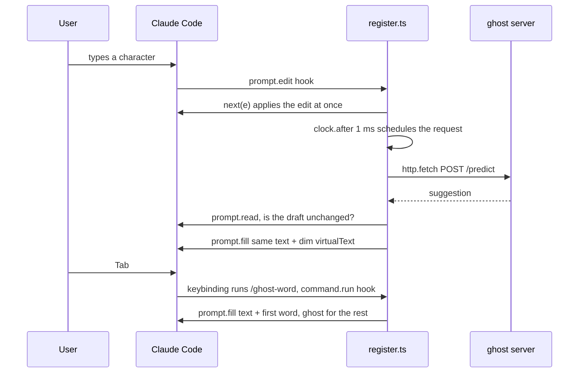

# Claude Code integration: ghost text in the prompt box

A Claude Code mod (a plugin with a hooks module, Claude Code 2.1.287+). While you type a prompt it asks the ghost policy server
(`pred serve`, on top of predictd) for a continuation and paints it as dim virtual text after the cursor: drawn, never part of the
draft until you accept it. The mod is only UI: what to ask and what to show is decided by the policy.

How it works (`hooks/register.ts`): a `prompt.edit` hook sees every edit; the request runs from a `$.clock.after` timer so typing is
never held up; the answer is painted with `$.prompt.fill` decorations (`virtualText`, `dimColor`) after checking the draft has not
changed. Typing a character that matches the ghost keeps the rest of it.



## Keys need a keybinding

Keys that do nothing at the end of the draft (Tab, →) never reach a `prompt.edit` hook, so the mod registers two slash commands and
the keys are bound to them in `keybindings.json`:

```json
{
  "bindings": [
    { "context": "Chat", "bindings": { "tab": "command:ghost-word", "right": "command:ghost-all" } }
  ]
}
```

| Key | Command | Effect |
|---|---|---|
| Tab | `/ghost-word` | accept one word of the ghost (the autocomplete menu keeps its own Tab) |
| → | `/ghost-all` | accept the whole ghost; with no ghost it moves the cursor right as usual |

**These bindings are global** (`~/.claude/keybindings.json` applies to every session). Add them only together with loading the mod in
every session (below); in a session without the mod, Tab and → would point at commands that do not exist.

## Try it (isolated, touches nothing in ~/.claude)

```sh
mkdir -p /tmp/cc-ghost && cat > /tmp/cc-ghost/keybindings.json <<'EOF'
{ "bindings": [ { "context": "Chat", "bindings": { "tab": "command:ghost-word", "right": "command:ghost-all" } } ] }
EOF
CLAUDE_CONFIG_DIR=/tmp/cc-ghost claude --plugin-dir <repo>/integrations/claude-code
```

A fresh `CLAUDE_CONFIG_DIR` runs Claude Code's first-run screens and asks to trust the folder again.

## Install for every session

Load the mod everywhere, e.g. `export CLAUDE_CODE_PLUGIN_DIRS=<repo>/integrations/claude-code` in `~/.zshrc.local` (or install it
from a local marketplace with `claude plugin marketplace add` / `claude plugin install`), then add the bindings above to
`~/.claude/keybindings.json`. Start the services with `bin/pred start` (the mod shows nothing while they are down; they exit
after 30 idle minutes, so run it again after a break, or from your shell startup).

Measured (2026-11-08, M4 Pro): ghost on screen 157 ms p50 / 205 ms max after the last keystroke (`bench/integration_latency.py`).
Validate after changes: `claude plugin validate integrations/claude-code`.
