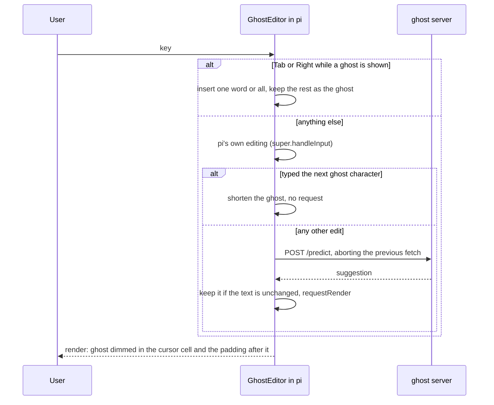

# pi integration: ghost text in pi's prompt editor

`ghost-editor.ts` replaces pi's prompt editor with a subclass (pi's public `CustomEditor` / `ctx.ui.setEditorComponent` API) that
asks the ghost policy server (`pred serve`, on top of predictd) for a continuation of the prompt as you type and draws it dim
after the cursor, fish-style. The extension is only UI: what to ask and what to show is decided by the policy.

| Key | Effect |
|---|---|
| Tab | accept one word of the ghost (pi's own Tab completion runs when no ghost is shown) |
| → / Ctrl+F | accept the whole ghost (only at the end of the text, where these keys do nothing in pi) |
| typing | a character that matches the ghost keeps the rest of it; anything else asks again |



The ghost appears only with the cursor at the end of the text, and not for `/commands` or `!shell` lines. It talks to
`http://127.0.0.1:$GHOST_PORT` (default 47321; if you change `serverPort` in `ghost/config.json`, set `GHOST_PORT` to match) and runs `bin/pred start` (predictd + the ghost
server) if nothing answers. Optional environment: `GHOST_PORT`, `GHOST_APP` (the app label sent to the policy, default
`coding agent prompt`), `PRED_CLI`.

## Try it

```sh
pi -e <repo>/integrations/pi/ghost-editor.ts
```

## Install for every pi session

pi auto-loads `~/.pi/agent/extensions/*.ts`. Keep the code in the repo and put a one-line loader there (a machine-local file):

```sh
mkdir -p ~/.pi/agent/extensions
echo "export { default } from \"$PWD/integrations/pi/ghost-editor.ts\";" > ~/.pi/agent/extensions/homeword.ts   # run in the repo
```

Remove that file to uninstall. If another extension also replaces the editor, the last one wins.

Last keystroke → ghost on screen (`bench/integration_latency.py`, Apple M4 Pro, macOS 27.2): 117 ms p50, under 200 ms max.
